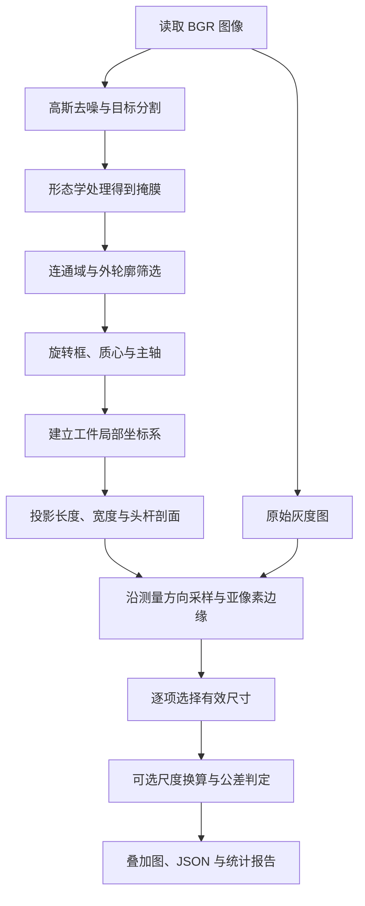

# ScrewMetrology

基于 C++17 / OpenCV 的离线螺钉定位、二维主轴估计与外形尺寸测量项目。输入图像，输出分割 mask、旋转框、局部坐标轴、像素／亚像素尺寸，以及可选的尺度换算和公差判定。


流程：BGR → 去噪 → Otsu / 自适应阈值 / Lab → 形态学 → 连通域与轮廓 → 旋转框 / PCA / fitLine → 局部坐标系 → 投影尺寸与头杆剖面 → 亚像素边缘 → 可选尺度换算与公差判定。

本 README 面向代码复盘：说明每个阶段为什么这样选、数据怎样变化、尺寸怎样计算，以及哪些结果还不能证明。准备工业视觉／图像算法面试时，配合阅读 [项目介绍与面试问答](docs/interview.md)，其中另有曝光、低对比度、反光和预处理专题。

## 当前进展

截至 2026-10-05，已完成共享测量流程与可读性整理、中间过程观察、三种主轴的固定候选量化对比。当前构建通过，CTest **12/12 通过**；默认算法参数、尺寸定义、质量规则及正式 JSON 行为保留。

| 验证范围 | 主要结果 | 证据与限制 |
| --- | --- | --- |
| 真实全量定位（2026-10-03） | 384 张图，召回 84.55%、精确率 83.31% | [历史验证](docs/validation.md)；评价定位，不是实物尺寸精度 |
| 三主轴对照（2026-10-05） | 16 张代表图、87 个匹配非近圆目标；PCA／fitLine／旋转框平均方向误差 0.7926°／1.0033°／5.6209° | [量化报告](docs/axis_comparison.md)；固定 mask 和候选，尚非三方法全量比较 |
| 合成尺寸链路 | 39 张真值图；PCA 杆宽 MAE 从像素 0.9359 px 降至优选 0.1030 px | 合成几何验证，不代替实物标定与独立尺寸真值 |
| 重构行为一致性 | 303 份 JSON／JSONL、668 张解码图像与基线一致 | 仅排除批次耗时，见 [验证范围](docs/axis_comparison.md#verification) |

下一阶段是明确导出头部端、分界和有向角，并用人工标注验证，见 [工作路线](docs/roadmap.md)。

## 阅读导航

- [场景与方案选择](#scene-and-choice)
- [构建与快速运行](#build-and-run)
- [流程讲解与主流程 2](#learning-flow)
- [为什么用 Lab 生成 mask](#lab-mask)
- [为什么用区域 PCA 求主轴](#pca-axis)
- [投影计算与头尾判别](#head-tail)
- [亚像素计算与回退](#subpixel)
- [动手实验与复盘清单](#learning-experiments)
- [中间过程面板与三类案例](docs/diagnostics.md)
- [三种主轴的量化对比](docs/axis_comparison.md)
- [曝光、过灰与排错](#learning-notes)
- [真实数据与复现](#dataset)
- [命令行与输出](#outputs)
- [尺度标定与公差](#scale-recipe)
- [评价与重复性](#evaluation)
- [工程结构](#structure)
- [下一步工作路线](docs/roadmap.md)
- [原理参考与版本](#references)

第一次学习建议先完成构建，在干净合成图上理解坐标、方向和尺寸，再观察真实木纹图的分割问题。历史实验数字来自 [2026-10-03 验证记录](docs/validation.md)；新增三种主轴对照的数字来自 [2026-10-05 量化报告](docs/axis_comparison.md)，两次验证范围分别说明。

<a id="scene-and-choice"></a>

## 场景与方案选择

当前任务是在离线图像中找到螺钉等工件，估计二维主轴并测量外形投影尺寸。真实样例来自 MVTec Screws：背景有偏黄木纹，工件有金属反光、暗部、交叉和遮挡。背景纹理与金属的亮度可能重叠，因此先利用颜色生成 mask，再沿工件自身方向测量。

| 要解决的问题 | 当前选择 | 选择的理由与适用边界 |
| --- | --- | --- |
| 木纹与金属的分离 | Lab 的 b 通道条件与 L 暗部条件取并集 | 利用场景颜色差异；有代表样例对比依据，但依赖背景、白平衡和照明 |
| 倾斜工件的测量方向 | 填充区域 PCA，另保留 fitLine、旋转框角度 | 以整个外形的面积分布估计主轴；近圆、粘连、大头部可能影响方向 |
| 头部在哪一端 | 主轴坐标下的宽度剖面 | 识别单端扩大和头杆分界；要求头杆差异可见，并非通用尖端检测 |
| 整数轮廓边缘的细化 | 原始灰度梯度峰与三点抛物线拟合 | 尝试得到小数像素边缘；失败时保留像素值，不保证所有尺寸都改善 |
| 是否能给出合格结论 | 几何质量、尺度与配方前提检查 | 可显示尺寸与可作可靠公差判定分开处理 |

本项目已实现传统视觉测量链路与可解释的失败记录；没有自动识别十三类规格、恢复遮挡尺寸、统一头尾方向角或实现曝光补偿。真实定位评价和合成尺寸验证是两类证据，后文分别介绍。

<a id="build-and-run"></a>

## 构建与快速运行

仅生产依赖 OpenCV 和 C++ 标准库。当前环境已验证 AppleClang 21、OpenCV 5.0.0、CMake；OpenCV 5 的几何 API 使用独立 `geometry` 模块。CMake 也保留 OpenCV 4 的头文件和链接路径，但没有在 OpenCV 4 环境实测。

```sh
cmake -S . -B build -DCMAKE_BUILD_TYPE=Debug
cmake --build build -j 4
ctest --test-dir build --output-on-failure
build/generate_samples data/synthetic
build/screw_metrology measure --input data/synthetic/images \
  --config config/synthetic.yaml --output result/synthetic \
  --mode single --recipe config/example_recipe_px.yaml
```

如果 CMake 找不到 OpenCV，在配置命令后加 `-DOpenCV_DIR=/path/to/opencv/lib/cmake/opencv5`，替换为本机实际安装路径；OpenCV 4 使用相应的包目录。VS Code 配置中的 OpenCV 路径也需按本机环境调整。无需相机、机械臂、GPU 或训练模型。

四个运行入口按用途区分：

| 入口 | 用途 | 使用说明 |
| --- | --- | --- |
| `screw_metrology` | 单图／批次测量、尺度参考与评价 | [命令行与输出](#outputs) |
| `main_test` | 本机窗口显示 3×4 分割与方向面板 | 下方手动实验说明 |
| `inspect_measurement` | 无窗口保存分割条件、局部 mask、剖面与梯度 | [中间过程文档](docs/diagnostics.md) |
| `compare_axes` + `tools/compare_axes.py` | 固定候选比较三种主轴，生成误差与覆盖率报告 | [主轴对比文档](docs/axis_comparison.md) |

`build/`、下载数据和 `result/` 中的运行图片／JSON 不上传到源码仓库；保留的示例图、配置、实验清单、报告文档和生成脚本用于复现。

### 用 `main_test.cpp` 逐步测试

`main_test` 是独立的手动实验程序，链接 `screw_core` 算法库与 OpenCV `highgui` 窗口模块。可以在 `main_test.cpp` 中逐步添加算法调用，无需修改正式命令行入口。

先执行上面的 CMake 配置命令，然后单独构建并运行：

```sh
cmake --build build --target main_test
./build/main_test
```

当前实验读取 `screws_153.png`（8 枚分离螺钉），展示 **3 行 × 4 列对比面板**：行是 Lab、Otsu、自适应阈值；列是二值图、PCA、fitLine、旋转框方向。每行共用同一张分割掩膜，后三列分别重新定位和测量，因此可以观察主轴选择对尺寸的影响。换图时修改 `image_path`；CMake 在编译时提供项目根目录，图片与输出路径均从项目根目录解析，因此也可在 `build/` 下执行 `./main_test`。读图失败会打印完整路径并退出。移动项目后重新配置和构建即可更新根目录。

入门样例建议按以下顺序学习：

| 图像路径 | 学习目的 |
| --- | --- |
| `data/synthetic/images/rotation_1.png` | 干净背景、单个合成螺钉，先理解 PCA、投影和头杆尺寸；使用 `blur=1`、`morph_open=1`、`morph_close=1`、`min_area=100` |
| `data/mvtec_screws/images/screws_153.png` | 分离的真实螺钉，使用当前参数，观察木纹和反光的影响 |
| `data/mvtec_screws/images/screws_001.png` | 交叉、粘连的困难图，观察候选过滤和漏检；更换主轴不能修复分割缺失 |

灰色背景的合成图优先用 Otsu 理解流程；当前 Lab 规则针对偏黄木纹背景，不保证适合合成图。三种方法的候选数量更多也不意味着检出更准确，需要检查是否选中了背景。

`main_test` 不接受命令行参数，运行后固定显示一个 **3×4 对比面板**，全部组合同时可见。总览只标编号和主轴，完整尺寸标签保存在详情图片中。总览中的彩色直线是无向主轴；绿色框表示几何质量可用，橙色框表示需要检查。没有尺度和配方时仍为 `NOT_EVALUATED`，绿色不表示公差 `OK`。同一行编号对应相同候选，跨行编号可能对应不同工件，不能直接当成匹配结果。

窗口获得键盘焦点后按 `Q` 或 `Esc` 退出，关闭窗口也会退出。程序自动把 `comparison.png` 和九张带标题的完整测量图保存到 `result/main_test/`，可直接打开图片查看细节。所有测量在原始分辨率上进行，总览缩放仅用于显示。当前 Lab/PCA 组合还会在 `result/main_test/process/` 保存分割条件、候选筛选、局部掩膜、宽度剖面和梯度曲线；这些数据来自同一次测量。

基础参数在 `experimentConfig()` 的 `config` 调参区；可在 `saveComparison()` 中的 `lab_config`、`otsu_config`、`adaptive_config` 处单独覆盖某行参数。对比流程会设置每个组合的 `segmentation` 与 `axis`，因此调整这两个基础字段不会减少对比组合。

需要不打开窗口直接保存过程图，可以使用新增学习入口：

```sh
cmake --build build --target inspect_measurement
build/inspect_measurement data/synthetic/images/rotation_1.png \
  config/synthetic.yaml result/diagnostics/normal
```

三个位置参数分别是图像、配置和输出目录；以 px 为单位保存像素及可用的亚像素测量，不加载尺度或配方。面板、CSV 字段、颜色与坐标说明，以及正常／真实反光／疑似粘连的案例解读，见 [测量中间过程](docs/diagnostics.md)。正式 `screw_metrology` 的参数与 JSON 字段保持原有行为。

VS Code 中选择“(lldb) 单步调试 main_test”，按 **F5** 自动配置、构建并在入口暂停。在需要观察的代码行设置断点；**F10** 执行下一行，**F11** 进入算法函数，**Shift+F11** 跳出函数。建议依次加入读图、分割、定位、尺寸测量，每完成一步，用 `cv::imshow` 查看中间图，再继续下一步。窗口显示需要本机图形桌面。

<a id="learning-flow"></a>

## 流程讲解：一张图如何变成测量结果

先分清三个问题：**分割**回答“哪些像素属于工件”，**定位**回答“工件在哪里、朝哪个方向”，**测量**回答“沿指定方向有多长、多宽”。前一阶段错误会传到后一阶段，调试时应按这个顺序排查。



### 主流程 2：mask 得到以后，循环在做什么

正式入口的 `processImage()` 在 [src/main.cpp](src/main.cpp)，实验入口的 `measureMask()` 在 [main_test.cpp](main_test.cpp)。它们共用 [measureObjects](src/pipeline.cpp)，调用方式为：

```cpp
result.objects = measureObjects(mask, gray, config, scale, recipe, mode == "single");
```

`mask` 与原始 `gray` 必须同尺寸、同坐标系。共享函数先调用一次 `candidates`，再交给内部的 `measureContoursImpl` 串联各阶段。下面是等价流程示意，省略可选诊断记录及排序编号；实际拆分见 [pipeline.cpp](src/pipeline.cpp)：

```cpp
for (const auto& contour : candidates(mask, config)) {
    Object object = locate(contour, gray.size(), config);
    measureObject(object, gray, config);
    applyScaleAndRecipe(object, gray.size(), scale, recipe, single_spec);
    objects.push_back(std::move(object));
}
```

`candidates(mask, config)` 返回所有通过筛选的外轮廓。每次循环处理一个候选的整组边界点，不是单个像素。候选也不等于确认的一枚螺钉：两枚粘连工件可能只有一个轮廓。主轴对照入口调用 `measureContours`，直接使用同一份已筛选轮廓，避免三个方案各自再筛一遍。

| 阶段 | 输入与处理 | 新得到的数据 |
| --- | --- | --- |
| `candidates` | 整图 mask → 连通域过滤 → 外轮廓过滤 | `vector<vector<Point>>`，每个内层向量是一条边界 |
| `locate` | 当前轮廓、图像尺寸、配置 | 轮廓、面积质心、旋转框、三种角度、选中主轴、质量原因 |
| `measureObject` | 同一个 Object、原始灰度图、配置 | 像素尺寸、可用亚像素尺寸、分界、细化状态及新增质量原因 |
| `applyScaleAndRecipe` | 已测量 Object、可选尺度与配方、模式 | 毫米尺寸、判定状态与判定原因 |
| `push_back` | 完整 Object 移入结果列表 | 本张图的目标集合；移动对象不会清空原图或 mask |

`measureObjects()` 在循环后按质心 `(y,x)` 排序并从 1 编号，再把集合交回入口生成叠加图和 JSON。质量不可靠的候选通常仍保存下来供检查；某张图处理抛出异常时，入口会清空该图的部分目标结果、记录错误，再继续下一张。

### 1. 读图与去噪：减少干扰，保留边界

输入是彩色图。`cv::imread` 读入 BGR，`GaussianBlur` 做轻度平滑，然后转换到灰度或 Lab 供分割使用。默认 `blur: 3` 表示 3×3 高斯核；核越大，噪声通常越少，但细螺纹和边缘也越容易模糊。

这里有两条图像路径：**分割使用去噪后的图像，亚像素测量使用原始图像转换的灰度图**。二值掩膜决定大致位置，原始灰度保留边缘附近的亮度变化。不要把二值图当成亚像素采样图。

<a id="lab-mask"></a>

### 2. 为什么采用 Lab 生成 mask

输出是 0/255 掩膜，白色为候选工件。每次只运行所选择的一种分割方法。

#### 灰度阈值为什么在这里容易选中木纹

灰度将 BGR 压缩成一个亮度值，近似 `gray = 0.114B + 0.587G + 0.299R`。不同颜色可以有相同灰度；木纹暗线、金属暗面和反光之间的亮度分布还可能交叠。Otsu 能优化灰度统计上的两类划分，却不知道哪类像素是螺钉。自动选阈值不等于自动理解物体。[灰度转换定义见 OpenCV 官方文档](https://docs.opencv.org/4.13.0/de/d25/imgproc_color_conversions.html)。

| 方法 | 计算依据 | 合适的场景 | 当前木纹场景的风险 |
| --- | --- | --- | --- |
| `otsu` | 选择使类间方差最大的全局阈值：`σ²(T)=ω₀ω₁(μ₀−μ₁)²` | 工件与背景灰度能较好分离，例如干净合成图 | 暗木纹也被选中，明亮金属区域可能被遗漏 |
| `adaptive` | 每个位置的阈值为局部高斯加权均值减 C | 光照缓慢变化且目标与局部背景有差异 | 木纹自身是局部明暗变化，也可能形成大量碎片 |
| `lab` | 对颜色 b 与亮度 L 分别设条件，取并集 | 当前偏黄背景与部分较中性的金属 | 暗背景、暖色反光、色偏和新背景仍可能导致误检／漏检 |

默认 Otsu 和自适应使用反向二值化，即较暗像素为白色前景。自适应窗口是 51×51，`adaptive_c=8`；局部方法不是一定优于全局方法，窗口与木纹尺度的关系也需要观察。

#### Lab 三个通道与代码的含义

Lab 中 L 表示明度，a 表示绿到红，b 表示蓝到黄。当前代码只使用 L 和 b。对于 OpenCV 的 `CV_8UC3` Lab 图，近似编码关系是：

```text
L8 = L* × 255 / 100
a8 = a* + 128
b8 = b* + 128
```

中性色的 b8 在 128 附近，较黄通常意味着 b8 较大。因此“b ≤ 145”并不是“只选蓝色”，而是接受相对不那么黄的区域。145 约对应 b*=17，90 约对应 L*=35.3；实际还有量化，不能与浮点 Lab 的阈值混用。[编码关系见 OpenCV 官方文档](https://docs.opencv.org/4.13.0/de/d25/imgproc_color_conversions.html)。

下面是 [segment 实现](src/segmentation.cpp) 的 Lab 分支摘录；`filtered` 是轻度高斯平滑后的 BGR：

```cpp
cv::Mat lab;
cv::cvtColor(filtered, lab, cv::COLOR_BGR2Lab);
std::vector<cv::Mat> channels;
cv::split(lab, channels);  // 0=L，1=a，2=b，都是 OpenCV 8 位编码
mask = (channels[2] <= config.lab_b_max) | (channels[0] <= config.lab_dark_l);
```

默认条件为 `b8 <= 145 || L8 <= 90`。矩阵比较返回 0/255，按位或 `|` 把两个条件的像素集合合并：较中性的金属可由 b 条件保留；部分颜色偏暖但很暗的金属可由 L 条件补回。若改成与条件，就要求像素同时满足两者，可能丢掉亮金属或偏暖暗面。

下面是解释条件的假想像素，不是样例图统计：

| 像素 | L8 | b8 | b 条件 | L 条件 | 最终 mask |
| --- | ---: | ---: | --- | --- | --- |
| 偏黄亮背景 | 180 | 165 | 否 | 否 | 0 |
| 中性亮金属 | 170 | 130 | 是 | 否 | 255 |
| 偏暖暗金属 | 70 | 160 | 否 | 是 | 255 |
| 很暗的木纹 | 60 | 160 | 否 | 是 | 255，可能误检 |

`invert: 1` 时，Lab 保留上述集合；`invert: 0` 时对它整体取反。Lab 提供颜色信息，但不意味着对曝光或白平衡不敏感；固定阈值仍然依赖拍摄场景。

#### 用什么证据选择 Lab

2026-10-03 的固定 16 张代表样例覆盖全部 13 类，有 180 个真值目标。参数按代表样例的 F1 选择 Lab 默认值，然后冻结；最终对比统一使用相同面积、形态学和其他配置，仅切换分割方法。

| 方法 | TP | FP | FN | 检出率 `TP/(TP+FN)` | 精确率 `TP/(TP+FP)` |
| --- | ---: | ---: | ---: | ---: | ---: |
| Otsu | 39 | 442 | 141 | 21.67% | 8.11% |
| 自适应阈值 | 4 | 417 | 176 | 2.22% | 0.95% |
| Lab | 144 | 30 | 36 | **80.00%** | **82.76%** |

这些是后续旋转框匹配得到的**定位指标**，不是像素级 mask IoU，也不是尺寸准确率。它们支持“当前背景、冻结配置下选 Lab”，不能证明 Lab 在所有图像上最好，也不是三种方法分别独立调优后的对比。代表样例参加了参数选择，且包含在全量评价中，不作为独立留出集。完整口径见 [验证记录](docs/validation.md)。

学习时先看 `.mask.png`：工件轮廓是否完整？背景木纹是否大量变白？相邻工件是否连在一起？这些问题没有解决，后续角度和尺寸通常也不可信。

### 3. 形态学：清理碎点，连接小裂缝

开运算是“先腐蚀、后膨胀”，用于去掉小白点或细小连接；闭运算是“先膨胀、后腐蚀”，用于连接小裂缝、填补小黑缺口。项目使用椭圆形结构元素，默认开运算 3×3、闭运算 11×11；配置为 1 相当于跳过该操作。

形态学会改变轮廓。闭运算过大会把两枚螺钉连成一个目标，开运算过大会删除细杆或尖端。因此不能只看“掩膜变干净了”，还要检查目标数量和尺寸是否被改变。

### 4. 连通域与轮廓：从像素得到候选工件

`connectedComponentsWithStats` 使用 8 邻域，把相连的白色像素归成一个区域，先按前景像素面积过滤。随后 `findContours` 提取外轮廓，再按轮廓面积和凸包占比过滤：

```text
solidity = 轮廓面积 / 凸包面积
```

凸包可以理解为用橡皮筋包住整个轮廓得到的外形。占比很低说明目标严重凹陷或破碎，可能是木纹、粘连或错误分割。当前筛选使用 `min_solidity`，定位阶段还会把占比低于 0.55 的保留候选标为疑似粘连；“留下来显示”与“允许可靠判定”是两件事。

前景像素面积与轮廓几何面积不是完全相同的计数，尤其是带孔工件。项目只用外轮廓做外形测量，不测量螺母内孔；两个物体一旦连通，也不会在这里自动拆开。

具体数据变化如下：先生成整型 `labels` 和统计表，背景标签为 0；面积通过的标签写入 `accepted`，据此重建 `kept`，再调用：

```cpp
cv::findContours(kept, contours, cv::RETR_EXTERNAL, cv::CHAIN_APPROX_NONE);
```

`RETR_EXTERNAL` 只取最外层边界；`CHAIN_APPROX_NONE` 不压缩边界上的直线点。输出只包含边界点，不包含内部所有像素。默认连通域像素数和轮廓几何面积都检查 1000～200000 的范围，轮廓至少 5 点，`solidity >= 0.25` 才保留。例如一条 10×10 的实心像素块有 100 个白色像素，而边界像素中心围成的方形面积是 9×9=81，两种面积不能直接当成同一个数。

<a id="pca-axis"></a>

### 5. 为什么用区域 PCA 求主轴

`minAreaRect` 给出最小面积旋转包围框，比轴对齐矩形更适合倾斜螺钉。轮廓矩用于求质心：`x_c = m10/m00`、`y_c = m01/m00`。质心与旋转框中心可能不同，例如较大的头部会使质心偏向头部。

主轴有三种可选方法，程序会记录全部方法的角度，默认采用 PCA：

| 方法 | 方向来自哪里 | 局限 |
| --- | --- | --- |
| `rect` | 旋转框的长边 | 局部突出或错误轮廓可能改变框的方向 |
| `pca` | 填充外轮廓内的全部前景像素，取最大方差方向 | 大头部、遮挡或粘连也可能改变面积分布 |
| `fitline` | 轮廓点的最小二乘直线拟合 | 轮廓点的分布与密度会影响方向 |

#### 从轮廓到协方差与主轴

[locate 实现](src/locator.cpp) 先把外轮廓平移到包围 ROI，再填充为实心掩膜。`findNonZero` 获取内部全部白色像素，组成 N×2 的 `CV_64F` 矩阵，每行是一点 `(x_i,y_i)`，以 `PCA::DATA_AS_ROW` 计算 PCA。内孔按实心处理；这组样本不是只有轮廓点。

教学推导可以写成：

```text
μ = (1/N) Σ P_i                  PCA 样本均值
C = (1/N) Σ (P_i−μ)(P_i−μ)^T     2×2 协方差矩阵
  = [ Var(x)    Cov(x,y) ]
    [ Cov(x,y)  Var(y)   ]
C v₁ = λ₁ v₁，C v₂ = λ₂ v₂，λ₁ ≥ λ₂
主轴方向 = v₁
θ = atan2(v₁.y, v₁.x) × 180/π，随后归一化到 [0°,180°)
```

沿螺钉长方向，区域像素通常更分散，所以最大特征值的特征向量通常接近长轴。PCA 自动以样本均值中心化；ROI 平移不改变协方差方向。局部测量原点则另用轮廓矩得到的面积质心，两者不需要完全相等。[PCA 基础可参考 OpenCV 教程](https://docs.opencv.org/4.13.0/d1/dee/tutorial_introduction_to_pca.html)；教程的轮廓采样方式与本项目的填充区域采样不同。

例如 `C = [[100,0],[0,4]]`，主轴为 `(1,0)`、特征值比为 25；旋转这组点后，最大方差方向也随形状旋转。当两特征值接近时，方向就没有足够区分度。

#### 采用区域 PCA 的理由与限制

区域 PCA 把外形内部像素都作为样本，减少仅由边界点采样密度决定方向的影响；旋转框更依赖极端边界，`fitLine` 则在本项目中对轮廓点作 L2 拟合。这里的 `fitLine` 没有使用 RANSAC，也不是鲁棒实例分离算法。区域 PCA 适合当前明显细长的外形，并能提供特征值比作为方向质量信号，但它仍受整个面积分布影响：巨大头部、错误填充、遮挡或两个粘连工件都可能拉偏主轴。

程序无论选择哪种方向，都会计算三种角度，并用 PCA 的 `λ₁/max(1e−9,λ₂)` 检查长轴明显程度。低于默认 `axis_ratio=1.3` 时记录 `axis_ambiguous` 且置 `reliable=false`；分母下限只用于避免除零，不保证退化目标可靠。碰边记录 `truncated`，`solidity<0.55` 记录 `possible_touching`，也会阻止可靠公差判定。

历史全量报告中，PCA 配置对 **2226 个成功匹配且真值框非近圆的目标**得到平均主轴误差 0.88°、最大 22.87°，方向按 180° 周期计算。它不包含漏检目标的方向误差，也不是头尾识别准确率。来源：[2026-10-03 验证记录](docs/validation.md)。

2026-10-05 新增了固定 mask、固定候选的三种方向量化对比：16 张代表图的 **87 个共同匹配且非近圆目标**，PCA／fitLine／旋转框平均误差为 **0.7926°／1.0033°／5.6209°**；39 张合成图还对比了五项尺寸误差、公共有效样本、细化覆盖率和模拟重复性。结果支持本场景保留 PCA，但尺寸没有一种方法处处最优；近圆、极宽头、粘连和遮挡控制案例也展示了失败范围。完整口径、表格及代码见 [三种主轴量化对比](docs/axis_comparison.md)。尚未完成 384 张全量的三方法比较，不宣称 PCA 普遍最优。

```sh
# 构建后运行；输出目录须为空，复跑另选目录。
python3 tools/compare_axes.py --output result/axis_comparison
```

### 6. 工件坐标系：让测量方向跟随旋转

设质心为 `O`，主轴角度为 `θ`，为工件建立两条单位轴：

```text
e_x = ( cosθ, sinθ)       沿螺钉主轴
e_y = (-sinθ, cosθ)       垂直于主轴

对于图像点 P：
s = (P - O) · e_x
t = (P - O) · e_y

反向转换：P = O + s * e_x + t * e_y
```

点积就是求一个点沿指定方向的投影。`(s,t)` 是工件局部坐标；原图中的螺钉即使倾斜，局部 x 轴仍沿着螺钉。这样总长、杆宽和测量 ROI 都可以跟随工件方向，不必手动调整水平矩形。

图像 y 向下，角度增加时轴向在图中顺时针旋转。输出角度归一化到 `[0°,180°)`：0° 与 180° 是同一条无向轴，当前没有把正方向统一为“头部指向尖端”。

手算一次坐标变换：设 `O=(100,100)`、`θ=30°`，局部点 `(s,t)=(20,5)` 映射到原图约为 `(114.821,114.330)`。减去 O 后再点乘两轴，可还原 `(20,5)`。同一条无向轴的 179° 与 1° 误差是 `min(178,180−178)=2°`；角度差不能直接取绝对值。

<a id="head-tail"></a>

### 7. 投影尺寸、宽度剖面与头尾判别

#### 先测整体投影范围

将外轮廓点转换到局部坐标，直接取两轴上的范围：

```text
length = max(s) - min(s)
width  = max(t) - min(t)
```

例如主轴投影从 −100 px 到 100 px，总长就是 200 px；换一个质心原点会使投影整体平移，但不会改变范围长度。整体宽度通常受到头部影响，不能当成杆宽。这里不是直接读取旋转框长宽，而是沿选中的主轴重新计算原始轮廓投影；边界像素中心范围不统一加 1。

#### 把当前候选旋转到局部 ROI

在 [measureObject](src/metrology.cpp) 中，只填充当前轮廓，再以 `warpAffine` 转到主轴水平的局部 ROI，避免把邻近候选一起扫描。外轮廓内部孔洞会被填满；已经粘连成同一轮廓的工件仍然不会被拆开。

设原始包围框左上角在局部坐标中为 `(s₀,t₀)`，源 ROI 点为 `(x',y')`，主轴 `e_x=(vx,vy)`。目标栅格的正向变换为：

```text
u = vx*x' + vy*y' + s₀ − smin + pad
v = −vy*x' + vx*y' + t₀ − tmin + pad
pad = 2
ROI 宽 = ceil(smax−smin) + 2*pad + 1
ROI 高 = ceil(tmax−tmin) + 2*pad + 1
```

留白防止旋转后边界被裁切；`INTER_NEAREST` 保持 0/255，不产生灰色像素。局部掩膜是用于宽度剖面的栅格近似，原始轮廓投影和原始灰度图仍分别保留。

#### 从逐列扫描得到宽度剖面

沿主轴逐列扫描，每列找白色像素最小／最大行号 `low、high`，只接受 `high>low` 的截面：

```text
s = u + smin − pad
t_low  = low  + tmin − pad
t_high = high + tmin − pad
width(s) = high − low
```

宽度是两侧边界位置差，不是这一列的白色像素个数。它表达“沿螺钉走到这个位置时有多宽”：

```text
局部 x：  头部             杆部
宽度：    较大 ────┐
                  └──────── 较小且相对稳定
```

若有效截面少于 10 个，直接保留整体投影长宽并返回；开启亚像素时还记录 `profile_too_short` 和 `fallback`。正常分支对每个截面及左右各 2 个邻近截面取中位数，得到平滑剖面 `profile`，端部窗口不足 5 点时使用现有点。中位数抑制局部毛刺与螺纹波动，但不能恢复不存在的轮廓。

#### 头部在哪一端：不是由 PCA 的正负号决定

设有效截面数为 N，代码中的比例对应截面数组索引并采用整数除法；它们近似表示轴向百分比，不是精确连续距离比例。步骤如下：

下面用 `shaft` 简写代码中的 `shaft_baseline`，用 `head_end`、`boundary` 简写 `analysis` 的同名成员；它们都是内部计算数据。

1. 用中间 `[30%N,70%N)` 的平滑宽度中位数估计杆宽基线 `shaft`。
2. 只对 `shaft>2 px`、`length>1.5*width` 且 `eigen_ratio>=axis_ratio` 的目标尝试头杆分离。
3. 比较负端和正端靠内约 5%～20% 的截面宽度中位数，减少尖端收缩和端面过渡的影响。
4. 设置 `at_left = 负端宽度 > head_ratio*shaft`，`at_right` 同理。默认 `head_ratio=1.25`；恰好一端成立才认为这一端有头部。
5. 从该端向内最多扫描约半个剖面，当连续 3 个截面满足 `profile[i] <= head_ratio*shaft`，且扫描超过约 5%N 时，取这 3 个截面的第一个为分界索引 `boundary`。负端为 `i−2`，正端为 `i+2`。

内部变量 `head_end=-1` 表示头在局部主轴负端，`+1` 表示在正端；“左右”是旋转后的局部坐标，不一定是原图左右。

```text
局部 s 递增 →

头在负端：  [ 宽头 ] |──────── 细杆 ────────   head_end = −1
                  分界 s_b
头在正端：  ──────── 细杆 ────────| [ 宽头 ]   head_end = +1
                               分界 s_b
```

#### 一个可手算的头杆示例

假设 N=200，平滑后中间杆宽为 20 px，两端采样宽度中位数分别为 40、20 px。阈值是 `1.25×20=25 px`，所以只有负端扩大。再假设索引 30、31、32 的宽度首次连续不大于 25，扫描到 32 时回取 `boundary=30`。

如果 `smin=−100`，这些连续截面间隔为 1 px，分界为 `s_b=−70`；`smax=100`，那么：

```text
总长 = 100 − (−100) = 200 px
头长 = s_b − smin = −70 − (−100) = 30 px
若头部轮廓 t 范围为 [−20,20]，头宽 = 40 px
若接受杆段的原始截面宽度中位数为 20，杆宽 = 20 px
```

对称的正端头部示例，分界若为 `s_b=70`，头长就是 `smax−s_b=30 px`。这些数字用于解释公式，不是某张图的输出。

| 尺寸字段 | 实际计算定义 |
| --- | --- |
| `length` | 全轮廓在 s 轴的范围 |
| `width` | 全轮廓在 t 轴的范围；两极值可能来自不同截面 |
| `head_length` | 识别到的头部端点到分界的 s 距离 |
| `head_width` | 分界头侧的原始轮廓点在 t 轴的范围，包含分界位置 |
| `shaft_width` | 非头部且索引在 `[20%N,80%N)` 的原始截面宽度中位数 |

头宽没有直接取某一列宽度，杆宽也没有直接复用最初的 `shaft` 基线。整体横向投影范围不一定等于某列最大宽度，因此这两个定义不能替换。

#### 判别失败与质量标记

两端同时扩大、都不扩大，或者搜索不到稳定分界时，正常剖面分支记录 `head_shaft_unavailable`，头杆尺寸保持缺失。短剖面更早返回，不一定同时出现这条原因。

粘连检查还使用 `[20%N,80%N)` 平滑宽度排序后的较低四分位值 `narrow_baseline`，降低中段被第二个物体撑宽而掩盖异常的风险。在细长目标分支中，两端都超过 `head_ratio*narrow_baseline` 时记录 `possible_touching_two_ends`；两端都超过杆宽阈值，或中间 30%～70% 内超过 `1.7*shaft` 的截面数大于约 10%N 时，记录 `possible_touching_profile`。这些情况置 `reliable=false`，但只是启发式检查，仍可能误报／漏报，不会重建遮挡尺寸。

**当前“头尾判别”准确的含义是：识别头部所在端，并估计头杆分界。** 主轴仍是无向轴，另一端按该头杆模型视为杆部末端，没有独立的尖端识别。`head_end` 保存在文件内部的 `HeadShaftAnalysis` 阶段结构中，也可由学习用旁路记录观察；`head_boundary` 保存局部 s 坐标供绘图使用，当前也没有导出到 JSON。导出的 `angle_deg` 不能解释为统一的“头指向尾”方向角。

<a id="subpixel"></a>

### 8. 亚像素边缘：利用灰度变化细化边界

轮廓点位于整数像素坐标，真实边缘可能落在两个像素之间。程序从粗边缘 p 出发，沿指定单位测量方向 n 提取原始灰度剖面。总长使用主轴，宽度使用垂直轴；它们是测量方向，在任意弯曲边界上不保证等于真实法线。

采样坐标为 `p+k*n`。设坐标为 `(x+dx,y+dy)`，x、y 为向下取整的整数坐标，`dx、dy∈[0,1)`，双线性插值为：

```text
I = (1−dy)[(1−dx)I(x,y) + dx*I(x+1,y)]
  + dy[(1−dx)I(x,y+1) + dx*I(x+1,y+1)]
g(k) = |I(k+1)−I(k−1)| / 2
```

默认 `edge_search=4`，梯度搜索范围为 −4～+4 px，采样两侧各多 1 点供中心差分使用。不区分暗到亮或亮到暗，寻找梯度幅值最大的位置。[refineEdge 实现](src/metrology.cpp) 返回沿 n 的有符号偏移，不是绝对图像坐标。

设峰值及左右相邻梯度为 `g_0`、`g_-`、`g_+`，小数偏移为：

```text
δ = 0.5 * (g_- - g_+) / (g_- - 2*g_0 + g_+)
细化边缘位置 = 梯度峰的整数采样位置 + δ
```

例如邻近梯度为 8、12、10，`δ=0.5*(8−10)/(8−24+10)=1/6 px`。由于两个边缘都沿同一个正向 n 求偏移，尺寸公式为：

```text
细化尺寸 = 像素尺寸 + 末端偏移 − 起点偏移
例：199 + 0.6 − (−0.4) = 200 px
```

如果粗边缘因形态学偏移太远，真实灰度边缘可能不在搜索范围内；扩大范围也可能采到螺纹、反光或另一条边界，不能无条件增大。

| 检查层次 | 失败条件与行为 |
| --- | --- |
| 单条边缘 | 双线性邻域出界、峰位于搜索端点、峰低于 `gradient_min=5`，返回缺失 |
| 峰的唯一性 | 距最大峰超过 2 个采样点，存在至少达到最大峰 80% 的另一局部峰，拒绝细化 |
| 拟合稳定性 | 曲率 `g_-−2g_0+g_+ >= −1e−6` 或 `abs(δ)>0.75`，拒绝细化 |
| 整体资格 | 总长两端都有效，且被尝试截面中至少 60% 的两侧细化成功、宽度为正，才继续发布整体结果 |
| 整体宽度 | 回到原始轮廓 t 极值位置细化；任一侧失败，清空整组 refined 并回退 |
| 合法几何 | 细化总长或整体宽度不大于 0，清空整组 refined 并回退 |
| 头宽与杆宽 | 头宽独立细化，失败只记该项原因；杆宽取成功且接受的杆段截面中位数，没有有效值则缺失 |

被尝试截面排除首尾两个截面。整体回退时 `subpixel_status=fallback`，像素值仍保留；头宽单项失败时整体可以仍为 `refined`。不开启细化时是 `disabled`。亚像素回退本身不会自动设置 `reliable=false`，几何可靠性和细化状态是不同信号。头杆分界并非主轴灰度边缘，`refined.head_length` 始终缺失。

**有小数位不代表测量准确。** 错误分割、反光、模糊、错误法线或错误尺度仍然会产生误差；本项目用合成真值和解析边缘测试检查细化效果。头杆分界仍是宽度剖面阈值，不是灰度边缘，因此头部长度不标称为亚像素测量。

### 9. 尺度与公差：把几何结果变成检验结果

程序先对每个尺寸选择有效亚像素值，否则使用像素值，得到 `preferred_px`。如有适用尺度，使用 `dimension_mm = dimension_px * mm_per_px` 换算毫米。

例如长度的像素值为 199、细化值为 200.25，头长的像素值为 30、细化值缺失，最终选择长度 200.25、头长 30。不能整组用 refined 替换 pixel，否则会丢失仍可用的头长。若尺度为 0.1 mm/px，分别是 20.025 mm、3 mm；未测得的字段仍为 `null`，不会变成 0。

公差判断的顺序是：混料展示模式 → 是否提供配方 → 几何是否可靠 → 毫米配方是否有适用尺度 → 每项尺寸是否可测且在范围内。只有全部必要条件满足才给出 `OK` 或 `NG`。因此默认出现 `NOT_EVALUATED` 是正常行为，应先查看 `reasons`，而不是直接放宽公差。

尺度换算在这些判定前提检查之前进行：即使几何不可靠，也可能保留展示用毫米值。配方上下限包含边界；任一必要字段缺失，整体仍为 `NOT_EVALUATED`，即使另一项已经越界。`quality_issues` 解释算法质量问题，`reasons` 解释最终为什么判定／未判定。

### 10. 导出与评价：验证输出，也验证误差

叠加图用于检查算法“看到了什么”，JSON 保存测量值及质量原因，评价报告回答“与真值相差多少”。三者要配合阅读：检测到一个框，不代表尺寸就可靠；公差返回 OK，也只表示满足你填写的配方。

旋转框标注只用于定位评价，不进入分割或尺寸计算。尺寸精度需要另外提供几何真值；当前真实数据没有毫米和头杆尺寸真值，因此用合成图验证测量链路，不能拿旋转框检出率代替毫米精度。

已有证据摘要如下，均来自 [2026-10-03 验证记录](docs/validation.md)，可核对 [机器可读汇总](docs/validation_summary.json)：

| 验证对象 | 已记录结果 | 不能由此推导的结论 |
| --- | --- | --- |
| 384 张真实图的定位 | 检出率 84.55%、精确率 83.31%，框中心平均距离 9.80 px | 实物尺寸精度、十三类识别准确率 |
| 匹配且非近圆目标的主轴 | 2226 项平均方向误差 0.88° | 所有目标都有可靠方向、头尾识别准确率 |
| 39 张合成图的杆宽 | 像素 MAE 0.9359 px，细化后 0.1030 px | 任意真实金属反光图都有同等改善 |
| 39 张合成图的总长／头长 | 最终 MAE 0.2476／0.9744 px | 头长已经实现亚像素、实物毫米精度已验证 |
| 30 次模拟重复测量 | 长度样本标准差 0.031709 px | 真实相机、装夹、照明及操作者的重复性或 GR&R |

注意总长、整体宽度、头宽的亚像素改善较小，不能把杆宽的改善比例套用到全部尺寸。后续实物验证需要固定成像条件、适用标定、独立尺寸真值及重复采集。

代码阅读顺序：先从 [measure 入口](src/main.cpp) 的 `processImage()` 进入 [共享流程](src/pipeline.cpp)，再看 [分割与筛选](src/segmentation.cpp)、[定位与坐标变换](src/locator.cpp)、[尺寸与亚像素](src/metrology.cpp)，最后看 [尺度和判定](src/calibration.cpp) 与 [评价](src/evaluation.cpp)。具体数据字段集中在 [types.hpp](include/screw/types.hpp)。

<a id="learning-experiments"></a>

## 动手实验：按这个顺序理解效果

先执行前面的构建和 `build/generate_samples data/synthetic`。以下命令均在项目根目录运行，输出使用独立目录，便于比较。

**实验一：先理解纯像素测量。** 在水平合成螺钉上关闭亚像素，打开掩膜、叠加图和 JSON，找到质心、主轴、头杆分界及五个尺寸。

```sh
build/screw_metrology measure --input data/synthetic/images/rotation_0.png \
  --config config/synthetic.yaml --no-subpixel --output result/learn/pixel
```

**实验二：旋转后尺寸应基本不变。** 把输入换为 `rotation_1.png`，它的角度为 17°，名义总长、头宽、杆宽仍分别为 200、40、20 px。观察轴跟着旋转，而尺寸只存在离散像素带来的小幅变化；分别用 `--axis pca`、`--axis fitline`、`--axis rect` 比较方向。

```sh
build/screw_metrology measure --input data/synthetic/images/rotation_1.png \
  --config config/synthetic.yaml --axis pca --no-subpixel --output result/learn/rotation
```

**实验三：比较亚像素的实际收益。** 同一张图开启细化，对比 JSON 的 `pixel`、`subpixel`、`preferred_px` 和 `subpixel_status`，再与名义几何值比较。水平合成图的像素总长可能是 199 px，这是边界像素中心范围的定义；细化后会接近连续边缘间的距离，不要手动给所有尺寸统一加 1。

```sh
build/screw_metrology measure --input data/synthetic/images/rotation_0.png \
  --config config/synthetic.yaml --output result/learn/subpixel
```

**实验四：看真实背景如何影响分割。** 同一张木纹图分别使用三种方法，先比较掩膜，再比较框和尺寸。默认冻结配置是木纹场景参数，不是合成图参数。

```sh
build/screw_metrology measure --input data/mvtec_screws/images/screws_025.png \
  --config config/measurement.yaml --segmentation otsu --output result/learn/otsu
build/screw_metrology measure --input data/mvtec_screws/images/screws_025.png \
  --config config/measurement.yaml --segmentation adaptive --output result/learn/adaptive
build/screw_metrology measure --input data/mvtec_screws/images/screws_025.png \
  --config config/measurement.yaml --segmentation lab --output result/learn/lab
```

**实验五：理解失败为什么不能判定为 OK。** 用 `data/synthetic/edge_cases/truncated.png` 和 `touching.png` 作单图输入，结合 `--config config/synthetic.yaml --mode single --recipe config/example_recipe_px.yaml`，查看 `reliable`、`quality_issues` 和 `reasons`。即使还能输出可见部分的长宽，截断或疑似粘连也会阻止可靠公差判定。

```sh
build/screw_metrology measure --input data/synthetic/edge_cases/truncated.png \
  --config config/synthetic.yaml --mode single --recipe config/example_recipe_px.yaml \
  --output result/learn/truncated
build/screw_metrology measure --input data/synthetic/edge_cases/touching.png \
  --config config/synthetic.yaml --mode single --recipe config/example_recipe_px.yaml \
  --output result/learn/touching
```

**实验六：跑通尺度与配方。** 用同一套合成图验证 200 px 的参考距离对应 20 mm，再按示例毫米配方检测。这里只演示程序如何换算与判定，不是一次实物标定。

```sh
build/screw_metrology calibrate-scale --input data/synthetic/images/rotation_0.png \
  --p1 100,100 --p2 300,100 --mm 20 --output result/learn/scale.yaml
build/screw_metrology measure --input data/synthetic/images/rotation_0.png \
  --config config/synthetic.yaml --scale result/learn/scale.yaml \
  --mode single --recipe config/example_recipe_mm.yaml --output result/learn/inspection
```

每次实验先回答三个问题：掩膜是否代表真实工件？测量方向和尺寸定义是否正确？结果为什么被判定或未判定？能解释这三个问题后，再修改参数。

### 对照代码复盘：断点与观察清单

| 阅读阶段 | 建议观察的变量／产物 | 应能自己回答的问题 |
| --- | --- | --- |
| `segment` | `filtered`、L/b 通道、形态学前后 mask | 某个木纹／金属像素为什么变白？核是否改变尖端？ |
| `candidates` | `stats` 面积、`kept`、轮廓面积、凸包面积 | 候选在哪一道过滤被删除？白像素数为何不等于轮廓面积？ |
| `locate` | `center`、`box.center`、PCA 特征值、三种角度 | 区域 PCA 与轮廓拟合的样本有什么不同？方向为何不可靠？ |
| `toLocal` / `toImage` | 同一点的原图坐标与 `(s,t)` | 正反变换能否还原？原点平移为何不改变尺寸？ |
| `projectContour` / `buildWidthProfile` | `projection`、`local_mask`、`slices` | 投影极值与旋转栅格怎样对应？为什么两者的宽高不能混用？ |
| `analyzeHeadShaft` / `measureHeadShaft` | `profile`、`shaft_baseline`、`analysis.head_end`、`analysis.boundary` | 头在哪端？3 个连续截面和分界坐标怎样对应？ |
| `refineEdge` | 灰度序列、梯度峰、`delta`、缺失返回 | 为什么拒绝弱峰或多峰？为什么两个端点偏移相减？ |
| 尺度与判定 | `pixel`、`refined`、`mm`、`reliable`、`reasons` | 哪些项来自细化？有毫米值为什么仍未判定？ |

其中 `local_mask`、`slices`、`profile` 和 `analysis.head_end` 来自文件内部阶段函数，可通过调试器或可选旁路记录观察；正式 JSON 不包含它们。过程面板及 CSV 的读取方式见 [观察文档](docs/diagnostics.md)；C++ 成员 `issues`、`refined` 在 JSON 中分别对应 `quality_issues`、`subpixel`。不要把没有导出的中间变量当成可直接读取的结果字段。

单因素对比时，为每次实验记录输入、配置、变化项、候选数、可靠目标数、细化状态和真值误差。比较分割固定主轴；比较主轴固定 mask；比较亚像素固定轮廓与方向。调高阈值后若候选增加，还要检查误检，不以目标数量作为唯一成绩。

<a id="learning-notes"></a>

## 注意事项与排错

### 曝光、过灰与预处理：先诊断，再增强

现有预处理只有分割分支的高斯平滑与二值形态学，没有曝光补偿、Gamma、CLAHE、白平衡或背景校正模块。下面是排查与后续实验建议，不是已完成的功能。完整原理、面试回答和 C++ 教学示例见 [成像与预处理专题](docs/interview.md#preprocessing)。

| 现象 | 先检查什么 | 优先措施与候选软件方案 | 对当前算法的影响 |
| --- | --- | --- | --- |
| 整体偏亮但细节仍在 | 直方图、亮部是否有层次、工件 ROI 的饱和比例 | 调曝光／增益；可实验亮度映射或 Gamma | 暗部 L 条件和梯度强度改变，需要重验 |
| 过曝发白、局部反光饱和 | 灰度与各 BGR 通道的高值连片，边缘是否消失 | 降曝光、调整光源角度、漫射照明；条件合适时试偏振 | 已截断的信息不能靠压暗恢复；可能断裂或出现错误边缘 |
| 偏暗且噪声明显 | 暗部直方图、黑色截断、帧间波动 | 增加有效照明；允许时延长曝光，谨慎提高增益 | Gamma 可提亮已有信号，同时也可能显露噪声 |
| 过灰、对比度低 | P95−P5 动态范围、目标两侧局部灰度差、是否失焦 | 拉伸、均衡化、CLAHE 作对照实验；先排除成像问题 | 增强也可能突出木纹或噪声，影响梯度峰和阈值 |
| 光照不均或阴影 | 同材质不同位置的亮度、空背景／参考帧 | 调均匀照明；实验背景校正、局部阈值 | 阴影会被 L 条件接收；局部阈值也可能选中纹理 |
| 色偏、白平衡漂移 | 同一参考区域的 L/a/b 是否漂移 | 固定白平衡和光源，再重新校验 Lab 阈值 | b 条件是场景参数，白平衡改变不能沿用旧成绩 |
| 噪声、失焦或运动模糊 | 噪声类型、边缘扩散、方向性拖影 | 匹配滤波；调焦、缩短运动曝光或改进触发 | 大核和锐化可能改变尺寸；锐化不能证明边缘被恢复 |

“看起来过灰”不一定是对比度问题，也可能是反光、失焦、镜头污渍或显示效果。全图直方图易被背景主导，应同时看工件附近 ROI。增强方案只放在独立实验分支，保持现有原始灰度测量基线；若改变亚像素采样图，也必须作为新的算法条件重新检查边缘偏移与尺寸误差。不要对三个 BGR 通道分别均衡化后仍假定原 Lab 阈值有效。

### 调参时一次只改变一个因素

先解决分割和目标数量，再解决主轴，最后检查尺寸与公差。复制配置为学习用 YAML 并通过 `--config` 指定，不直接覆盖用于正式评价的冻结配置；改参数后不能继续引用旧报告作为新配置的成绩。

| 参数 | 它控制什么 | 常见副作用 |
| --- | --- | --- |
| `blur` | 分割前平滑程度 | 过大会模糊尖端和小结构 |
| `adaptive_block` / `adaptive_c` | 局部阈值的窗口和偏移 | 木纹也可能被分成大量白色区域 |
| `lab_b_max` / `lab_dark_l` | 金属颜色和暗部的接受条件 | 提高阈值可能补回工件，也会接受更多木纹与阴影 |
| `morph_open` / `morph_close` | 清噪与连接裂缝 | 过大会削掉细杆或把相邻目标合并 |
| `min_area` / `max_area` | 候选区域的大小范围 | 太高会漏小工件，太低会保留碎片；更换分辨率后要重新检查 |
| `axis_ratio` | 主轴明确程度 | 降低门槛不等于圆形目标突然有了可靠方向 |
| `head_ratio` | 头部相对杆部的宽度门槛 | 太高可能找不到头部，太低可能把螺纹波动当成头部 |
| `gradient_min` / `edge_search` | 亚像素边缘强度与搜索范围 | 门槛太低容易选噪声，范围太大可能选到另一条边缘 |

核尺寸须为允许范围内的正奇数，`adaptive_block` 至少为 3。算法可以拒绝非法参数，但不能判断合法参数是否适合当前拍摄场景。

### 结果异常时优先检查这些地方

| 现象或字段 | 优先排查 |
| --- | --- |
| 0 个目标，但程序返回 0 | 掩膜是否几乎全黑/全白，颜色条件是否适用，面积过滤是否过严；返回 0 只表示处理成功 |
| 木纹上出现大量小框 | 阈值把背景选中了；先修分割，再调整面积过滤，不能靠删小框解决全部背景问题 |
| 一枚螺钉出现多个框 | 反光使掩膜断裂；观察颜色条件与闭运算，防止补裂缝时连上邻近工件 |
| 两枚螺钉变成一个框 | 原图已接触/遮挡或闭运算过大；当前没有通用实例拆分与遮挡尺寸恢复 |
| `axis_ambiguous` / `possible_touching*` / `truncated` | 方向不明确、疑似粘连或碰到图像边界；先检查轮廓，不能只调宽公差 |
| `head_shaft_unavailable` | 目标可能是螺母，或头杆差异不明显，也可能是分割/主轴错误；整体长宽可存在，头杆字段仍可能为 `null` |
| `subpixel_status: fallback` | 查看弱梯度、多峰、出界或截面不足；像素值仍可用，但不能当成已经细化 |
| `scale_resolution_mismatch` / `no_applicable_scale` | 尺度分辨率不匹配或没有适用尺度；毫米字段不应靠猜测补齐 |
| `mixed_display_mode` / `no_recipe` | 默认混料展示模式或没有配方；确认单规格后再使用 `--mode single --recipe ...` |
| `<尺寸>:unavailable` / `<尺寸>:out_of_range` | 前者表示必要尺寸不可测，后者表示该项越界；两者同时出现时整体仍可能是未判定 |

### 测量和评价最容易混淆的地方

- **角度有周期。** 179° 与 1° 的无向主轴误差是 2°，不是 178°。PCA 主轴不包含头尾方向，二维角度也不是三维位姿。
- **宽度有定义。** 最大投影宽度、头部宽度、杆部外轮廓宽度不能互换；当前也不测螺纹小径、真实圆柱直径或螺母内孔。
- **尺度有适用条件。** 同分辨率不代表同尺度；裁剪、缩放、焦距、拍摄距离、工件高度或平面倾角改变后，都要重新确认尺度。当前不做畸变与透视矫正。
- **配方不是分类器。** `--mode single` 是使用者确认单规格，程序不会检查每个目标是不是该型号。示例上下限不能直接用于未知实物。
- **质量与判定分开看。** 能输出尺寸、小数位很多或框是绿色，都不代表可靠且合格；结合 `reliable`、质量问题、状态和原因判断。`NOT_EVALUATED` 不能当成 OK，也不能作为明确尺寸 NG。
- **旋转框不是尺寸真值。** 定位成功不能证明毫米测量准确；检出率、尺寸误差、重复性是不同指标，真实精度需要适用标定和独立真值。
- **目标编号不是追踪 ID。** 每张图重新按位置编号；做重复性 CSV 时，要核对每图的 `target_id`，并用 `part_id` 关联同一实物。重复性反映测量波动，不能证明不存在固定偏差，也不能代替 GR&R。
- **比较要保持条件一致。** 同一张图只切换一个方法或参数，保留独立输出目录；评价只统计匹配目标的误差时，还必须同时看漏检和误检数量，避免只关注好测量的样本。

运行命令时从项目根目录开始。批次输入变化后使用新的输出目录：程序会覆盖同名产物，但不会清空旧 JSON，评价目录时旧结果可能混入。真实图像学习实验需要先取得数据；公开数据的使用和分享也需遵循包内许可。

<a id="dataset"></a>

## 真实数据与复现

使用 [MVTec Screws](https://www.mvtec.com/research-teaching/datasets/mvtec-screws)，不是 MVTec AD 中的 `screw` 异常检测子集。官方说明有 384 张图像、13 类、4,426 条旋转框标注；当前下载的 V1.0 原始包实际有 **4,427 条唯一标注**，报告按实际包统计，不丢弃任何一条。

```sh
# Python >=3.9，仅使用标准库；数据包约 1.3 GB。
python3 tools/download_dataset.py
build/screw_metrology measure --input data/mvtec_screws/images \
  --config config/measurement.yaml --output result/mvtec_full
build/screw_metrology evaluate --results result/mvtec_full \
  --annotations data/mvtec_screws/mvtec_screws.json --output result/mvtec_evaluation

# 一次复现测试、合成 px/mm 流程、三种分割对比和真实全量报告。
python3 tools/run_validation.py
```

下载工具使用 Neuromatch 项目材料中的 OSF 公开镜像，校验 SHA-256 并检查解压路径；`data/mvtec_screws/SOURCE.json` 记录来源和数量。数据许可证为 **CC BY-NC-SA 4.0**，作者为 MVTec Software GmbH，许可与引用见原包 `README_v1.0.txt`。项目不要求 HALCON，不读取 `.hdict`。

固定代表图像名单为 `config/representative.txt`，共 16 张，覆盖全部 13 类。参数只在代表样例调整，然后冻结；全量报告包含这些样例，因此属于数据集整体复现结果，不宣称为独立留出集性能。最新指标及限制见 [验证记录](docs/validation.md)。

<a id="outputs"></a>

## 命令行与输出

```sh
build/screw_metrology --help
build/screw_metrology measure --input image.png --output result/single
build/screw_metrology measure --input images --config config/measurement.yaml \
  --segmentation lab --axis pca --no-subpixel --output result/batch
```

`--input` 为单张图或目录，目录处理当前层的 PNG/JPEG/BMP/TIFF，按文件名排序。同名不同扩展名会造成输出冲突，程序会拒绝。单图或批处理的目标按质心 y、x 排序，从 1 编号；相邻目标编号可能随图像变化，不能将它用于跨图像追踪。

每张图生成 `<stem>.mask.png`、`<stem>.overlay.png`、`<stem>.json`，另生成 `batch_summary.json`。JSON 中不可测字段是真正的 `null`，不使用零值替代。示例字段：

```json
{
  "id": 1,
  "center": [308.5, 239.5],
  "angle_deg": 0,
  "pixel": {"length": 199, "width": 39, "head_length": 30, "head_width": 39, "shaft_width": 19},
  "subpixel": {"length": 200.25, "width": 40.25, "head_length": null, "head_width": 40.25, "shaft_width": 20.25},
  "status": "NOT_EVALUATED",
  "reasons": ["mixed_display_mode"]
}
```

实际 JSON 还包含旋转框、各方法角度、主轴、质量问题、`preferred_px`、毫米结果、完整算法参数、尺度来源和公差配方。`preferred_px` 对每一项优先使用有效亚像素值，否则使用像素值；毫米换算与公差都使用该选择。`subpixel_status` 为 `disabled`、`refined` 或 `fallback`。

叠加图显示包围框、轮廓、质心、局部坐标轴、长度线和可用的头杆分界。蓝色箭头是局部 x，紫色是局部 y；橙色框表示几何质量需要检查。`N/E` 表示未作公差判定，绿色框本身不代表尺寸合格。

尺寸定义、头杆判别和质量条件集中见 [计算实现](#head-tail)，细化规则见 [亚像素计算](#subpixel)。这些宽度都是图像上的外形投影，不能直接当成真实圆柱直径、螺纹小径或螺母内孔尺寸。配置见 `config/measurement.yaml`（木纹场景）和 `config/synthetic.yaml`（干净合成背景）；换场景或分辨率后需重新检查。

<a id="scale-recipe"></a>

## 尺度标定与公差

```sh
build/screw_metrology calibrate-scale --input reference.png \
  --p1 100,100 --p2 300,100 --mm 20 --output result/scale.yaml
build/screw_metrology measure --input same_setup_images \
  --scale result/scale.yaml --mode single --recipe config/example_recipe_mm.yaml \
  --output result/inspection
```

公式是 `mm_per_px = known_mm / norm(p2-p1)`，参考点必须位于图内、至少相距 1 px。尺度文件记录参考图像、分辨率、参考点、已知长度和尺度。尺寸分辨率不匹配时毫米字段保持 `null`。

该尺度只适用于 **同一固定拍摄设置、同平面、近似正视** 的图像。相同分辨率不能证明拍摄条件相同，需要使用者保证；本版本未作畸变或透视矫正。MVTec 图像没有毫米真值，默认不附加尺度。合成示例的 0.1 mm/px 只是用于验证换算链路。

配方 YAML 包含 `name`、`unit: px|mm` 和 `limits`，各项范围 `[min,max]` 包含边界。支持 `length`、`width`、`head_length`、`head_width`、`shaft_width`。示例配方仅用于合成演示，实际规格需自行填写。

默认 `--mode mixed` 只展示几何结果。指定 `--mode single` 表示用户确认本次图像为配方对应的单规格工件；程序不会自动验证类别。

- `OK`：几何可靠，全部配置项可测且在范围内。
- `NG`：几何可靠，全部配置项可测，至少一项越界。
- `NOT_EVALUATED`：混料模式、缺少配方/适用尺度、几何不可靠或必要尺寸不可测。部分项已越界而其他必要项缺失时仍为未判定，原因会完整记录。

<a id="evaluation"></a>

## 评价与重复性

旋转框评价读取 MVTec 原生 JSON。包内定义为 `(row,col,width,height,phi)`，宽高为全长度、`phi` 为逆时针弧度，row/col 相对 OpenCV 像素中心多 0.5；转换为 `(col-0.5,row-0.5,-phi*180/pi)`。按 IoU 降序进行阈值 0.5 的一对一匹配。

报告检出率、精确率、中心距离、方向误差和每类召回率；真实框长宽比小于 1.3 时不计方向误差。`center_error_px` 比较预测旋转框中心与标注旋转框中心，另单独记录质心与标注框中心距离；旋转框中心不是工件质心真值。定位误差只统计成功匹配项。未判定公差的目标仍参与定位检出统计，两类验证含义不同。

`report.json` 为汇总，`images.jsonl` 列出逐图匹配、漏检和误检编号，`failures/` 保存红色漏检框和黄色误检框的缩略图。代表样例评价明确列出未参与评价的图像；全量评价应有 384 张且缺失列表为空。坏图保留错误 JSON，计入失败图像与对应漏检。

尺寸真值或重复拍摄清单采用 CSV：

```csv
image,target_id,part_id,measurement,truth,unit
capture_01.png,1,screw_A,length,40.02,mm
capture_02.png,1,screw_A,length,40.02,mm
capture_03.png,1,screw_A,length,,mm
```

```sh
build/screw_metrology evaluate --results result/inspection \
  --truth measured_truth.csv --output result/dimension_evaluation
```

`target_id` 为该图 JSON 的目标编号；`part_id` 用于跨图像关联同一个实物。`truth` 可空，表示只参与重复性；不可靠或不可测目标会列出排除原因。报告测量减真值的有符号平均误差、MAE、最大绝对误差、误差样本标准差，并按工件、测量项、单位分组计算测量样本标准差（N−1，少于两次时为 `null`）。px 真值同时比较像素和有效亚像素结果，亚像素覆盖数随之报告。

<a id="structure"></a>

## 工程结构

```text
include/screw/    数据类型与分割、定位、测量、标定、评价接口
src/             核心算法、JSON 输出、可视化与命令行
config/          冻结算法参数、合成配置、公差示例、代表样例名单
tests/           CTest 行为测试、C++ 合成数据生成器
tools/           标准库下载、完整复现与主轴对照统计脚本
docs/            验证记录、测量示例、面试文档、过程观察、主轴对比与工作路线
result/          运行结果（不纳入源码版本管理）
```

入口与内部函数按职责组织，阅读时可以先看每个模块的公共函数，再逐个进入阶段：

| 文件 | 主入口与阶段 |
| --- | --- |
| [src/main.cpp](src/main.cpp) | `parseOptions → loadMeasurementOptions → runMeasurement`；逐图走 `prepareResult → processImage`，最后汇总 |
| [src/pipeline.cpp](src/pipeline.cpp) | `measureObjects` 统一候选、定位、测量、尺度配方与排序编号；`measureContours` 接收固定候选，复用后续阶段供量化实验使用 |
| [src/metrology.cpp](src/metrology.cpp) | `measureObject` 串联 `projectContour → buildWidthProfile → analyzeHeadShaft → measureHeadShaft → refineDimensions`；阶段结构和规则常量仅在文件内可见 |
| [src/io.cpp](src/io.cpp) | `saveResult` 按配方、配置、尺度和对象写 JSON；`loadResult` 恢复评价所需字段 |
| [src/evaluation.cpp](src/evaluation.cpp) | 定位评价拆为标注读取、IoU 贪心匹配、逐图统计及报告；尺寸评价拆为真值读取、样本选择、统计及报告 |
| [src/visualization.cpp](src/visualization.cpp) | 几何绘制、标签内容、标签位置与文字绘制分开处理 |
| [main_test.cpp](main_test.cpp) | `experimentConfig → saveComparison → showComparison`；保持读图、参数校验和原始灰度准备在 `main` |
| [src/diagnostics.cpp](src/diagnostics.cpp) | 读取可选过程记录绘图与保存 CSV，不重新运行算法；无窗口入口为 `inspect_measurement` |
| [src/compare_axes.cpp](src/compare_axes.cpp)、[tools/compare_axes.py](tools/compare_axes.py) | 每图一次分割与筛选，分别测量三种主轴；串联原评价入口，统计公共样本、覆盖率与失败 |
| [tests/test_core.cpp](tests/test_core.cpp) | 旋转与头杆、亚像素、尺度、公差、质量、读写和评价分组；另验证共享流程的空图、排序编号与质量状态 |

公共数据类型及默认值保持原有成员顺序；既有算法接口仍可单独调用。共享流程不负责读图、分割、文件输出或窗口事件。下一步功能的目标、产物和验收方式见 [工作路线](docs/roadmap.md)。

原相机标定、PnP、手眼标定程序与构建入口已移除；原有数据和根目录图片保留。程序成功（包括没有目标）返回 0；参数错误、坏图或输出失败返回 1，批处理继续处理其他图像并汇总失败。没有自采标定图和卡尺真值，因此当前不声明实物毫米精度、真实重复性或工业 GR&R。

<a id="references"></a>

## 原理参考与版本

项目历史验证环境是 C++17、macOS arm64、AppleClang 21、OpenCV **5.0.0**（2026-10-03）。以下固定到 **OpenCV 4.13.0** 的官方页面用于解释基础原理，不作为项目在该版本上通过构建的声明；本项目 PCA 的区域采样及质量阈值以源码为准。

- [颜色转换与 8 位 Lab 编码](https://docs.opencv.org/4.13.0/de/d25/imgproc_color_conversions.html)
- [PCA 与方向估计教程](https://docs.opencv.org/4.13.0/d1/dee/tutorial_introduction_to_pca.html)
- [直方图均衡化与 CLAHE](https://docs.opencv.org/4.13.0/d5/daf/tutorial_py_histogram_equalization.html)：用于面试文档的候选预处理方案，当前生产流程未使用。

继续阅读：[项目介绍、面试问答与成像排查](docs/interview.md)，[下一步工作路线](docs/roadmap.md)。
