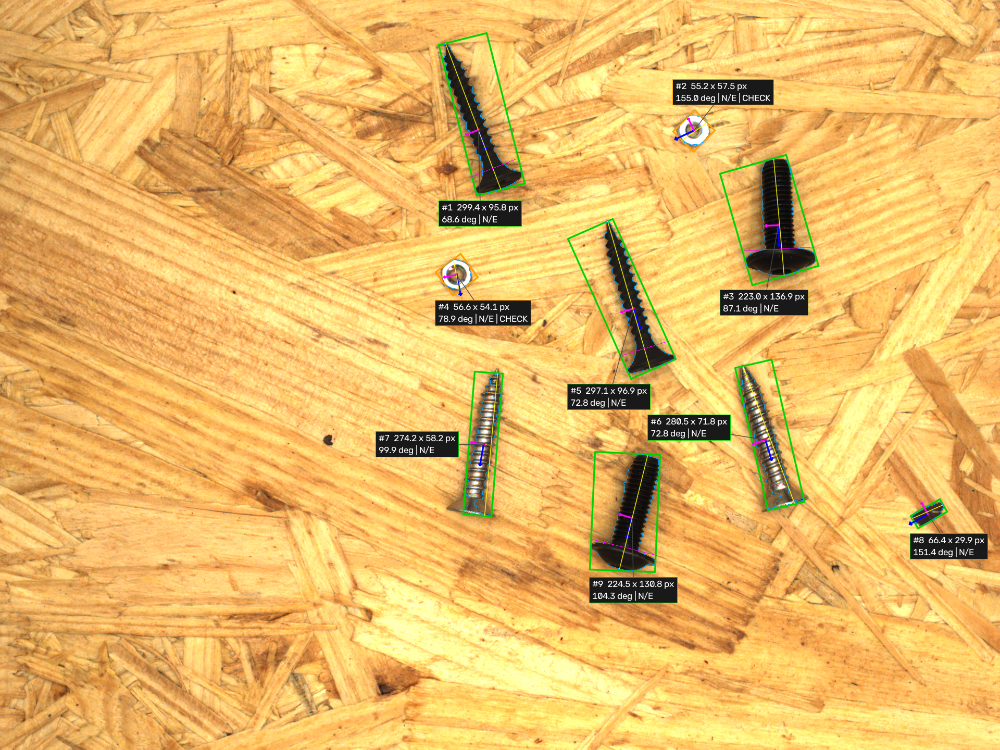
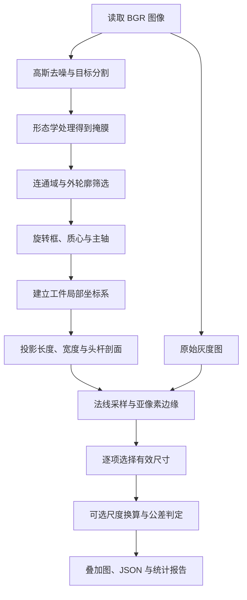

# ScrewMetrology

基于 C++17 / OpenCV 的螺钉定位、姿态估计与几何尺寸检测系统。输入离线图像，输出分割、旋转框、工件坐标轴、尺寸和可解释的公差判定。



流程：BGR → 去噪 → Otsu / 自适应阈值 / Lab → 形态学 → 连通域与轮廓 → 旋转框 / PCA / fitLine → 局部坐标系 → 投影尺寸与头杆剖面 → 亚像素边缘 → 可选尺度换算与公差判定。

第一次学习建议先完成下面的构建，再按“[流程讲解](#learning-flow) → [动手实验](#learning-experiments) → [注意事项与排错](#learning-notes)”阅读。先在干净合成图上理解几何，再看真实木纹图上的分割问题。

## 构建与快速运行

仅生产依赖 OpenCV 和 C++ 标准库。当前环境已验证 AppleClang 21、OpenCV 5.0.0、CMake；OpenCV 5 的几何 API 使用独立 `geometry` 模块。CMake 也保留 OpenCV 4 的头文件和链接路径，但没有在 OpenCV 4 环境实测。

```sh
cmake -S . -B build -DCMAKE_BUILD_TYPE=Debug \
  -DOpenCV_DIR=/Volumes/chutian/opt/conda/envs/dev/lib/cmake/opencv5
cmake --build build -j 4
ctest --test-dir build --output-on-failure
build/generate_samples data/synthetic
build/screw_metrology measure --input data/synthetic/images \
  --config config/synthetic.yaml --output result/synthetic \
  --mode single --recipe config/example_recipe_px.yaml
```

其他环境将 `OpenCV_DIR` 替换为实际安装目录。VS Code 的构建任务和调试入口已更新。无需相机、机械臂、GPU 或训练模型。

### 用 `main_test.cpp` 逐步测试

`main_test` 是独立的手动实验程序，链接 `screw_core` 算法库与 OpenCV `highgui` 窗口模块。可以在 `main_test.cpp` 中逐步添加算法调用，无需修改正式命令行入口。

先执行上面的 CMake 配置命令，然后单独构建并运行：

```sh
cmake --build build --target main_test
./build/main_test
```

当前实验读取 `screws_153.png`（8 枚分离螺钉），展示 **3 行 × 4 列对比面板**：行是 Lab、Otsu、自适应阈值；列是二值图、PCA、fitLine、旋转框方向。每行共用同一张分割掩膜，后三列分别重新定位和测量，因此可以观察主轴选择对尺寸的影响。换图时修改 `image_path`；CMake 在编译时提供项目根目录，图片与输出路径均从项目根目录解析，因此也可在 `build/` 下执行 `./main_test`。读图失败会打印完整路径并退出。移动项目后重新配置和构建即可更新根目录。

入门样例建议按以下顺序学习：

| 图像路径 | 学习目的 |
| --- | --- |
| `data/synthetic/images/rotation_1.png` | 干净背景、单个合成螺钉，先理解 PCA、投影和头杆尺寸；使用 `blur=1`、`morph_open=1`、`morph_close=1`、`min_area=100` |
| `data/mvtec_screws/images/screws_153.png` | 分离的真实螺钉，使用当前参数，观察木纹和反光的影响 |
| `data/mvtec_screws/images/screws_001.png` | 交叉、粘连的困难图，观察候选过滤和漏检；更换主轴不能修复分割缺失 |

灰色背景的合成图优先用 Otsu 理解流程；当前 Lab 规则针对偏黄木纹背景，不保证适合合成图。三种方法的候选数量更多也不意味着检出更准确，需要检查是否选中了背景。

`main_test` 不接受命令行参数，运行后固定显示一个 **3×4 对比面板**，全部组合同时可见。总览只标编号和主轴，完整尺寸标签保存在详情图片中。总览中的彩色直线是无向主轴；绿色框表示几何质量可用，橙色框表示需要检查。没有尺度和配方时仍为 `NOT_EVALUATED`，绿色不表示公差 `OK`。同一行编号对应相同候选，跨行编号可能对应不同工件，不能直接当成匹配结果。

窗口获得键盘焦点后按 `Q` 或 `Esc` 退出，关闭窗口也会退出。程序自动把 `comparison.png` 和九张带标题的完整测量图保存到 `result/main_test/`，可直接打开图片查看细节。所有测量在原始分辨率上进行，总览缩放仅用于显示。

基础参数在 `config` 调参区；可在 `lab_config`、`otsu_config`、`adaptive_config` 处单独覆盖某行参数。对比流程会设置每个组合的 `segmentation` 与 `axis`，因此调整这两个基础字段不会减少对比组合。

VS Code 中选择“(lldb) 单步调试 main_test”，按 **F5** 自动配置、构建并在入口暂停。在需要观察的代码行设置断点；**F10** 执行下一行，**F11** 进入算法函数，**Shift+F11** 跳出函数。建议依次加入读图、分割、定位、尺寸测量，每完成一步，用 `cv::imshow` 查看中间图，再继续下一步。窗口显示需要本机图形桌面。

<a id="learning-flow"></a>

## 流程讲解：一张图如何变成测量结果

先分清三个问题：**分割**回答“哪些像素属于工件”，**定位**回答“工件在哪里、朝哪个方向”，**测量**回答“沿指定方向有多长、多宽”。前一阶段错误会传到后一阶段，调试时应按这个顺序排查。



### 1. 读图与去噪：减少干扰，保留边界

输入是彩色图。`cv::imread` 读入 BGR，`GaussianBlur` 做轻度平滑，然后转换到灰度或 Lab 供分割使用。默认 `blur: 3` 表示 3×3 高斯核；核越大，噪声通常越少，但细螺纹和边缘也越容易模糊。

这里有两条图像路径：**分割使用去噪后的图像，亚像素测量使用原始图像转换的灰度图**。二值掩膜决定大致位置，原始灰度保留边缘附近的亮度变化。不要把二值图当成亚像素采样图。

### 2. 目标分割：把工件变白，背景变黑

输出是 0/255 掩膜，白色为候选工件。每次只运行所选择的一种分割方法。

| 方法 | 如何区分目标 | 适合先观察什么 |
| --- | --- | --- |
| `otsu` | 根据整张灰度直方图自动选择一个阈值 | 干净合成图上目标和背景的亮度差异 |
| `adaptive` | 对不同位置使用局部阈值 | 局部亮度变化，以及木纹被当成目标的问题 |
| `lab` | 利用颜色通道和暗部条件选出金属 | 金属与偏黄木纹的差异，以及暖色反光造成的断裂 |

当前 Lab 条件是 `b <= lab_b_max` **或** `L <= lab_dark_l`，默认分别为 145 和 90。这些值针对 OpenCV 转换后的 **8 位 Lab 通道**，不要直接套用其他软件或浮点 Lab 的数值。`invert: 1` 时，Otsu/自适应阈值选择暗目标；Lab 保留上述条件。`invert: 0` 时反转对应选择。

学习时先看 `.mask.png`：工件轮廓是否完整？背景木纹是否大量变白？相邻工件是否连在一起？这些问题没有解决，后续角度和尺寸通常也不可信。

### 3. 形态学：清理碎点，连接小裂缝

开运算是“先腐蚀、后膨胀”，用于去掉小白点或细小连接；闭运算是“先膨胀、后腐蚀”，用于连接小裂缝、填补小黑缺口。项目使用椭圆形结构元素，默认开运算 3×3、闭运算 11×11；配置为 1 相当于跳过该操作。

形态学会改变轮廓。闭运算过大会把两枚螺钉连成一个目标，开运算过大会删除细杆或尖端。因此不能只看“掩膜变干净了”，还要检查目标数量和尺寸是否被改变。

### 4. 连通域与轮廓：从像素得到候选工件

`connectedComponentsWithStats` 使用 8 邻域，把相连的白色像素归成一个区域，先按前景像素面积过滤。随后 `findContours` 提取外轮廓，再按轮廓面积和凸包占比过滤：

```text
solidity = 轮廓面积 / 凸包面积
```

凸包可以理解为用橡皮筋包住整个轮廓得到的外形。占比很低说明目标严重凹陷或破碎，可能是木纹、粘连或错误分割。当前筛选使用 `min_solidity`，定位阶段还会把占比低于 0.55 的保留候选标为疑似粘连；“留下来显示”与“允许可靠判定”是两件事。

前景像素面积与轮廓几何面积不是完全相同的计数，尤其是带孔工件。项目只用外轮廓做外形测量，不测量螺母内孔；两个物体一旦连通，也不会在这里自动拆开。

### 5. 定位与姿态：找中心，再找长轴

`minAreaRect` 给出最小面积旋转包围框，比轴对齐矩形更适合倾斜螺钉。轮廓矩用于求质心：`x_c = m10/m00`、`y_c = m01/m00`。质心与旋转框中心可能不同，例如较大的头部会使质心偏向头部。

主轴有三种可选方法，程序会记录全部方法的角度，默认采用 PCA：

| 方法 | 方向来自哪里 | 局限 |
| --- | --- | --- |
| `rect` | 旋转框的长边 | 局部突出或错误轮廓可能改变框的方向 |
| `pca` | 填充外轮廓内的全部前景像素，取最大方差方向 | 大头部、遮挡或粘连也可能改变面积分布 |
| `fitline` | 轮廓点的最小二乘直线拟合 | 轮廓点的分布与密度会影响方向 |

PCA 的两个特征值描述沿两条正交方向的分散程度。它们的比值接近 1，说明形状没有明显长轴，例如接近圆形的螺母；低于 `axis_ratio` 时标记 `axis_ambiguous`。PCA 不保证总是比另外两种方法准确，应结合轮廓和真值比较。

### 6. 工件坐标系：让测量方向跟随旋转

设质心为 `O`，主轴角度为 `θ`，为工件建立两条单位轴：

```text
e_x = ( cosθ, sinθ)       沿螺钉主轴
e_y = (-sinθ, cosθ)       垂直于主轴

对于图像点 P：
s = (P - O) · e_x
t = (P - O) · e_y

反向转换：P = O + s * e_x + t * e_y
```

点积就是求一个点沿指定方向的投影。`(s,t)` 是工件局部坐标；原图中的螺钉即使倾斜，局部 x 轴仍沿着螺钉。这样总长、杆宽和测量 ROI 都可以跟随工件方向，不必手动调整水平矩形。

图像 y 向下，角度增加时轴向在图中顺时针旋转。输出角度归一化到 `[0°,180°)`：0° 与 180° 是同一条无向轴，当前没有把正方向统一为“头部指向尖端”。

### 7. 几何测量：投影范围与宽度剖面

将外轮廓点转换到局部坐标，直接取两轴上的范围：

```text
length = max(s) - min(s)
width  = max(t) - min(t)
```

例如主轴投影从 −100 px 到 100 px，总长就是 200 px；换一个质心原点会使投影整体平移，但不会改变范围长度。最大宽度通常受到头部影响，不能当成杆宽。

要区分头部和杆部，程序把填充轮廓的掩膜旋转到局部 ROI，使用最近邻插值保留二值属性，沿主轴逐列扫描，得到 `width(s)`。它表达“螺钉走到这个位置时有多宽”：

```text
局部 x：  头部             杆部
宽度：    较大 ────┐
                  └──────── 较小且相对稳定
```

程序对剖面作中位数平滑，估计中部杆宽，并检查是否只有一端明显变宽；从头部一侧寻找连续变窄的位置作为分界。`head_ratio` 控制相对宽度阈值。随后测量头部轴向长度、头部轮廓的横向投影范围，以及接受杆段的截面宽度中位数。形状没有明显头杆差异时，相应字段保持 `null`，不强行套用螺钉模型。

### 8. 亚像素边缘：利用灰度变化细化边界

轮廓点位于整数像素坐标，真实边缘可能落在两个像素之间。程序从粗边缘出发，沿测量边缘法线提取原始灰度剖面，使用双线性插值取样；再计算中心差分梯度的绝对值，在峰值附近拟合抛物线。

设峰值及左右相邻梯度为 `g_0`、`g_-`、`g_+`，小数偏移为：

```text
δ = 0.5 * (g_- - g_+) / (g_- - 2*g_0 + g_+)
细化边缘位置 = 梯度峰的整数采样位置 + δ
```

总长细化沿主轴进行，宽度细化沿垂直轴进行。`edge_search` 控制粗边缘两侧的搜索范围，`gradient_min` 排除过弱边缘；多峰、越界、拟合不稳定或有效截面不足会触发降级。整体长宽细化失败时使用像素结果，头部/杆部宽度还可能各自缺少有效细化值。

**有小数位不代表测量准确。** 错误分割、反光、模糊、错误法线或错误尺度仍然会产生误差；本项目用合成真值和解析边缘测试检查细化效果。头杆分界仍是宽度剖面阈值，不是灰度边缘，因此头部长度不标称为亚像素测量。

### 9. 尺度与公差：把几何结果变成检验结果

程序先对每个尺寸选择有效亚像素值，否则使用像素值，得到 `preferred_px`。如有适用尺度，使用 `dimension_mm = dimension_px * mm_per_px` 换算毫米。

公差判断的顺序是：混料展示模式 → 是否提供配方 → 几何是否可靠 → 毫米配方是否有适用尺度 → 每项尺寸是否可测且在范围内。只有全部必要条件满足才给出 `OK` 或 `NG`。因此默认出现 `NOT_EVALUATED` 是正常行为，应先查看 `reasons`，而不是直接放宽公差。

### 10. 导出与评价：验证输出，也验证误差

叠加图用于检查算法“看到了什么”，JSON 保存测量值及质量原因，评价报告回答“与真值相差多少”。三者要配合阅读：检测到一个框，不代表尺寸就可靠；公差返回 OK，也只表示满足你填写的配方。

旋转框标注只用于定位评价，不进入分割或尺寸计算。尺寸精度需要另外提供几何真值；当前真实数据没有毫米和头杆尺寸真值，因此用合成图验证测量链路，不能拿旋转框检出率代替毫米精度。

代码阅读顺序：先从 [measure 入口](src/main.cpp) 看调用链，再看 [分割与筛选](src/segmentation.cpp)、[定位与坐标变换](src/locator.cpp)、[尺寸与亚像素](src/metrology.cpp)，最后看 [尺度和判定](src/calibration.cpp) 与 [评价](src/evaluation.cpp)。具体数据字段集中在 [types.hpp](include/screw/types.hpp)。

<a id="learning-experiments"></a>

## 动手实验：按这个顺序理解效果

先执行前面的构建和 `build/generate_samples data/synthetic`。以下命令均在项目根目录运行，输出使用独立目录，便于比较。

**实验一：先理解纯像素测量。** 在水平合成螺钉上关闭亚像素，打开掩膜、叠加图和 JSON，找到质心、主轴、头杆分界及五个尺寸。

```sh
build/screw_metrology measure --input data/synthetic/images/rotation_0.png \
  --config config/synthetic.yaml --no-subpixel --output result/learn/pixel
```

**实验二：旋转后尺寸应基本不变。** 把输入换为 `rotation_1.png`，它的角度为 17°，名义总长、头宽、杆宽仍分别为 200、40、20 px。观察轴跟着旋转，而尺寸只存在离散像素带来的小幅变化；分别用 `--axis pca`、`--axis fitline`、`--axis rect` 比较方向。

```sh
build/screw_metrology measure --input data/synthetic/images/rotation_1.png \
  --config config/synthetic.yaml --axis pca --no-subpixel --output result/learn/rotation
```

**实验三：比较亚像素的实际收益。** 同一张图开启细化，对比 JSON 的 `pixel`、`subpixel`、`preferred_px` 和 `subpixel_status`，再与名义几何值比较。水平合成图的像素总长可能是 199 px，这是边界像素中心范围的定义；细化后会接近连续边缘间的距离，不要手动给所有尺寸统一加 1。

```sh
build/screw_metrology measure --input data/synthetic/images/rotation_0.png \
  --config config/synthetic.yaml --output result/learn/subpixel
```

**实验四：看真实背景如何影响分割。** 同一张木纹图分别使用三种方法，先比较掩膜，再比较框和尺寸。默认冻结配置是木纹场景参数，不是合成图参数。

```sh
build/screw_metrology measure --input data/mvtec_screws/images/screws_025.png \
  --config config/measurement.yaml --segmentation otsu --output result/learn/otsu
build/screw_metrology measure --input data/mvtec_screws/images/screws_025.png \
  --config config/measurement.yaml --segmentation adaptive --output result/learn/adaptive
build/screw_metrology measure --input data/mvtec_screws/images/screws_025.png \
  --config config/measurement.yaml --segmentation lab --output result/learn/lab
```

**实验五：理解失败为什么不能判定为 OK。** 用 `data/synthetic/edge_cases/truncated.png` 和 `touching.png` 作单图输入，结合 `--config config/synthetic.yaml --mode single --recipe config/example_recipe_px.yaml`，查看 `reliable`、`quality_issues` 和 `reasons`。即使还能输出可见部分的长宽，截断或疑似粘连也会阻止可靠公差判定。

```sh
build/screw_metrology measure --input data/synthetic/edge_cases/truncated.png \
  --config config/synthetic.yaml --mode single --recipe config/example_recipe_px.yaml \
  --output result/learn/truncated
build/screw_metrology measure --input data/synthetic/edge_cases/touching.png \
  --config config/synthetic.yaml --mode single --recipe config/example_recipe_px.yaml \
  --output result/learn/touching
```

**实验六：跑通尺度与配方。** 用同一套合成图验证 200 px 的参考距离对应 20 mm，再按示例毫米配方检测。这里只演示程序如何换算与判定，不是一次实物标定。

```sh
build/screw_metrology calibrate-scale --input data/synthetic/images/rotation_0.png \
  --p1 100,100 --p2 300,100 --mm 20 --output result/learn/scale.yaml
build/screw_metrology measure --input data/synthetic/images/rotation_0.png \
  --config config/synthetic.yaml --scale result/learn/scale.yaml \
  --mode single --recipe config/example_recipe_mm.yaml --output result/learn/inspection
```

每次实验先回答三个问题：掩膜是否代表真实工件？测量方向和尺寸定义是否正确？结果为什么被判定或未判定？能解释这三个问题后，再修改参数。

<a id="learning-notes"></a>

## 注意事项与排错

### 调参时一次只改变一个因素

先解决分割和目标数量，再解决主轴，最后检查尺寸与公差。复制配置为学习用 YAML 并通过 `--config` 指定，不直接覆盖用于正式评价的冻结配置；改参数后不能继续引用旧报告作为新配置的成绩。

| 参数 | 它控制什么 | 常见副作用 |
| --- | --- | --- |
| `blur` | 分割前平滑程度 | 过大会模糊尖端和小结构 |
| `adaptive_block` / `adaptive_c` | 局部阈值的窗口和偏移 | 木纹也可能被分成大量白色区域 |
| `lab_b_max` / `lab_dark_l` | 金属颜色和暗部的接受条件 | 提高阈值可能补回工件，也会接受更多木纹与阴影 |
| `morph_open` / `morph_close` | 清噪与连接裂缝 | 过大会削掉细杆或把相邻目标合并 |
| `min_area` / `max_area` | 候选区域的大小范围 | 太高会漏小工件，太低会保留碎片；更换分辨率后要重新检查 |
| `axis_ratio` | 主轴明确程度 | 降低门槛不等于圆形目标突然有了可靠方向 |
| `head_ratio` | 头部相对杆部的宽度门槛 | 太高可能找不到头部，太低可能把螺纹波动当成头部 |
| `gradient_min` / `edge_search` | 亚像素边缘强度与搜索范围 | 门槛太低容易选噪声，范围太大可能选到另一条边缘 |

核尺寸须为允许范围内的正奇数，`adaptive_block` 至少为 3。算法可以拒绝非法参数，但不能判断合法参数是否适合当前拍摄场景。

### 结果异常时优先检查这些地方

| 现象或字段 | 优先排查 |
| --- | --- |
| 0 个目标，但程序返回 0 | 掩膜是否几乎全黑/全白，颜色条件是否适用，面积过滤是否过严；返回 0 只表示处理成功 |
| 木纹上出现大量小框 | 阈值把背景选中了；先修分割，再调整面积过滤，不能靠删小框解决全部背景问题 |
| 一枚螺钉出现多个框 | 反光使掩膜断裂；观察颜色条件与闭运算，防止补裂缝时连上邻近工件 |
| 两枚螺钉变成一个框 | 原图已接触/遮挡或闭运算过大；当前没有通用实例拆分与遮挡尺寸恢复 |
| `axis_ambiguous` / `possible_touching*` / `truncated` | 方向不明确、疑似粘连或碰到图像边界；先检查轮廓，不能只调宽公差 |
| `head_shaft_unavailable` | 目标可能是螺母，或头杆差异不明显，也可能是分割/主轴错误；整体长宽可存在，头杆字段仍可能为 `null` |
| `subpixel_status: fallback` | 查看弱梯度、多峰、出界或截面不足；像素值仍可用，但不能当成已经细化 |
| `scale_resolution_mismatch` / `no_applicable_scale` | 尺度分辨率不匹配或没有适用尺度；毫米字段不应靠猜测补齐 |
| `mixed_display_mode` / `no_recipe` | 默认混料展示模式或没有配方；确认单规格后再使用 `--mode single --recipe ...` |
| `<尺寸>:unavailable` / `<尺寸>:out_of_range` | 前者表示必要尺寸不可测，后者表示该项越界；两者同时出现时整体仍可能是未判定 |

### 测量和评价最容易混淆的地方

- **角度有周期。** 179° 与 1° 的无向主轴误差是 2°，不是 178°。PCA 主轴不包含头尾方向，二维角度也不是三维位姿。
- **宽度有定义。** 最大投影宽度、头部宽度、杆部外轮廓宽度不能互换；当前也不测螺纹小径、真实圆柱直径或螺母内孔。
- **尺度有适用条件。** 同分辨率不代表同尺度；裁剪、缩放、焦距、拍摄距离、工件高度或平面倾角改变后，都要重新确认尺度。当前不做畸变与透视矫正。
- **配方不是分类器。** `--mode single` 是使用者确认单规格，程序不会检查每个目标是不是该型号。示例上下限不能直接用于未知实物。
- **质量与判定分开看。** 能输出尺寸、小数位很多或框是绿色，都不代表可靠且合格；结合 `reliable`、质量问题、状态和原因判断。`NOT_EVALUATED` 不能当成 OK，也不能作为明确尺寸 NG。
- **旋转框不是尺寸真值。** 定位成功不能证明毫米测量准确；检出率、尺寸误差、重复性是不同指标，真实精度需要适用标定和独立真值。
- **目标编号不是追踪 ID。** 每张图重新按位置编号；做重复性 CSV 时，要核对每图的 `target_id`，并用 `part_id` 关联同一实物。重复性反映测量波动，不能证明不存在固定偏差，也不能代替 GR&R。
- **比较要保持条件一致。** 同一张图只切换一个方法或参数，保留独立输出目录；评价只统计匹配目标的误差时，还必须同时看漏检和误检数量，避免只关注好测量的样本。

运行命令时从项目根目录开始。批次输入变化后使用新的输出目录：程序会覆盖同名产物，但不会清空旧 JSON，评价目录时旧结果可能混入。真实图像学习实验需要先取得数据；公开数据的使用和分享也需遵循包内许可。

## 真实数据与复现

使用 [MVTec Screws](https://www.mvtec.com/research-teaching/datasets/mvtec-screws)，不是 MVTec AD 中的 `screw` 异常检测子集。官方说明有 384 张图像、13 类、4,426 条旋转框标注；当前下载的 V1.0 原始包实际有 **4,427 条唯一标注**，报告按实际包统计，不丢弃任何一条。

```sh
# Python >=3.9，仅使用标准库；数据包约 1.3 GB。
python3 tools/download_dataset.py
build/screw_metrology measure --input data/mvtec_screws/images \
  --config config/measurement.yaml --output result/mvtec_full
build/screw_metrology evaluate --results result/mvtec_full \
  --annotations data/mvtec_screws/mvtec_screws.json --output result/mvtec_evaluation

# 一次复现测试、合成 px/mm 流程、三种分割对比和真实全量报告。
python3 tools/run_validation.py
```

下载工具使用 Neuromatch 项目材料中的 OSF 公开镜像，校验 SHA-256 并检查解压路径；`data/mvtec_screws/SOURCE.json` 记录来源和数量。数据许可证为 **CC BY-NC-SA 4.0**，作者为 MVTec Software GmbH，许可与引用见原包 `README_v1.0.txt`。项目不要求 HALCON，不读取 `.hdict`。

固定代表图像名单为 `config/representative.txt`，共 16 张，覆盖全部 13 类。参数只在代表样例调整，然后冻结；全量报告包含这些样例，因此属于数据集整体复现结果，不宣称为独立留出集性能。最新指标及限制见 [验证记录](docs/validation.md)。

## 命令行与输出

```sh
build/screw_metrology --help
build/screw_metrology measure --input image.png --output result/single
build/screw_metrology measure --input images --config config/measurement.yaml \
  --segmentation lab --axis pca --no-subpixel --output result/batch
```

`--input` 为单张图或目录，目录处理当前层的 PNG/JPEG/BMP/TIFF，按文件名排序。同名不同扩展名会造成输出冲突，程序会拒绝。单图或批处理的目标按质心 y、x 排序，从 1 编号；相邻目标编号可能随图像变化，不能将它用于跨图像追踪。

每张图生成 `<stem>.mask.png`、`<stem>.overlay.png`、`<stem>.json`，另生成 `batch_summary.json`。JSON 中不可测字段是真正的 `null`，不使用零值替代。示例字段：

```json
{
  "id": 1,
  "center": [308.5, 239.5],
  "angle_deg": 0,
  "pixel": {"length": 199, "width": 39, "head_length": 30, "head_width": 39, "shaft_width": 19},
  "subpixel": {"length": 200.25, "width": 40.25, "head_length": null, "head_width": 40.25, "shaft_width": 20.25},
  "status": "NOT_EVALUATED",
  "reasons": ["mixed_display_mode"]
}
```

实际 JSON 还包含旋转框、各方法角度、主轴、质量问题、`preferred_px`、毫米结果、完整算法参数、尺度来源和公差配方。`preferred_px` 对每一项优先使用有效亚像素值，否则使用像素值；毫米换算与公差都使用该选择。`subpixel_status` 为 `disabled`、`refined` 或 `fallback`。

叠加图显示包围框、轮廓、质心、局部坐标轴、长度线和可用的头杆分界。蓝色箭头是局部 x，紫色是局部 y；橙色框表示几何质量需要检查。`N/E` 表示未作公差判定，绿色框本身不代表尺寸合格。

## 测量定义与质量

- 图像 x 向右、y 向下；局部原点为填充外轮廓的质心，局部 x 为所选主轴，局部 y 与它正交。`angle_deg` 在 `[0°,180°)`，表示无向二维主轴，不能解释为完整三维姿态或头部朝向。
- PCA 使用填充外轮廓的全部前景像素；`--axis fitline` 使用轮廓拟合，`--axis rect` 使用旋转矩形长边。三种角度都保留用于比较。螺母内孔不参与外形尺寸定义。
- `length`、`width` 是轮廓沿局部两轴的投影范围；像素级坐标基于边界像素中心。`width` 是最大投影宽度，不等于杆径。
- 头杆识别对主轴 ROI 建立每像素截面宽度剖面，平滑后寻找端部扩大和稳定杆段。`head_width` 是头部区域轮廓在垂直主轴方向的投影范围，`shaft_width` 是接受杆段外轮廓宽度的中位数。它们是投影外形宽度，不能直接当成真实圆柱直径或螺纹小径。
- 亚像素测量在原始灰度图上沿边缘法线双线性采样，对中心差分梯度峰作三点二次插值。弱梯度、多峰、出界或有效截面不足会降级。头杆分界采用剖面阈值，`subpixel.head_length` 保持 `null`。
- 截断、严重凹陷、两端异常扩大和主轴不明确会标记不可靠。粘连检测属于形状启发式，仍可能漏掉重叠；木纹、暖色反光和密集摆放可能造成碎片或合并。没有实现遮挡后的尺寸恢复或十三类自动识别。

配置见 `config/measurement.yaml`（真实木纹场景）和 `config/synthetic.yaml`（干净合成背景）。阈值是场景参数，不是适用于所有相机与背景的通用值；未知配置键、非法核尺寸和范围会报错。

## 尺度标定与公差

```sh
build/screw_metrology calibrate-scale --input reference.png \
  --p1 100,100 --p2 300,100 --mm 20 --output result/scale.yaml
build/screw_metrology measure --input same_setup_images \
  --scale result/scale.yaml --mode single --recipe config/example_recipe_mm.yaml \
  --output result/inspection
```

公式是 `mm_per_px = known_mm / norm(p2-p1)`，参考点必须位于图内、至少相距 1 px。尺度文件记录参考图像、分辨率、参考点、已知长度和尺度。尺寸分辨率不匹配时毫米字段保持 `null`。

该尺度只适用于 **同一固定拍摄设置、同平面、近似正视** 的图像。相同分辨率不能证明拍摄条件相同，需要使用者保证；本版本未作畸变或透视矫正。MVTec 图像没有毫米真值，默认不附加尺度。合成示例的 0.1 mm/px 只是用于验证换算链路。

配方 YAML 包含 `name`、`unit: px|mm` 和 `limits`，各项范围 `[min,max]` 包含边界。支持 `length`、`width`、`head_length`、`head_width`、`shaft_width`。示例配方仅用于合成演示，实际规格需自行填写。

默认 `--mode mixed` 只展示几何结果。指定 `--mode single` 表示用户确认本次图像为配方对应的单规格工件；程序不会自动验证类别。

- `OK`：几何可靠，全部配置项可测且在范围内。
- `NG`：几何可靠，全部配置项可测，至少一项越界。
- `NOT_EVALUATED`：混料模式、缺少配方/适用尺度、几何不可靠或必要尺寸不可测。部分项已越界而其他必要项缺失时仍为未判定，原因会完整记录。

## 评价与重复性

旋转框评价读取 MVTec 原生 JSON。包内定义为 `(row,col,width,height,phi)`，宽高为全长度、`phi` 为逆时针弧度，row/col 相对 OpenCV 像素中心多 0.5；转换为 `(col-0.5,row-0.5,-phi*180/pi)`。按 IoU 降序进行阈值 0.5 的一对一匹配。

报告检出率、精确率、中心距离、方向误差和每类召回率；真实框长宽比小于 1.3 时不计方向误差。`center_error_px` 比较预测旋转框中心与标注旋转框中心，另单独记录质心与标注框中心距离；旋转框中心不是工件质心真值。定位误差只统计成功匹配项。未判定公差的目标仍参与定位检出统计，两类验证含义不同。

`report.json` 为汇总，`images.jsonl` 列出逐图匹配、漏检和误检编号，`failures/` 保存红色漏检框和黄色误检框的缩略图。代表样例评价明确列出未参与评价的图像；全量评价应有 384 张且缺失列表为空。坏图保留错误 JSON，计入失败图像与对应漏检。

尺寸真值或重复拍摄清单采用 CSV：

```csv
image,target_id,part_id,measurement,truth,unit
capture_01.png,1,screw_A,length,40.02,mm
capture_02.png,1,screw_A,length,40.02,mm
capture_03.png,1,screw_A,length,,mm
```

```sh
build/screw_metrology evaluate --results result/inspection \
  --truth measured_truth.csv --output result/dimension_evaluation
```

`target_id` 为该图 JSON 的目标编号；`part_id` 用于跨图像关联同一个实物。`truth` 可空，表示只参与重复性；不可靠或不可测目标会列出排除原因。报告测量减真值的有符号平均误差、MAE、最大绝对误差、误差样本标准差，并按工件、测量项、单位分组计算测量样本标准差（N−1，少于两次时为 `null`）。px 真值同时比较像素和有效亚像素结果，亚像素覆盖数随之报告。

## 工程结构

```text
include/screw/    数据类型与分割、定位、测量、标定、评价接口
src/             核心算法、JSON 输出、可视化与命令行
config/          冻结算法参数、合成配置、公差示例、代表样例名单
tests/           CTest 行为测试、C++ 合成数据生成器
tools/           标准库下载与完整复现脚本
docs/            验证记录与测量示例
result/          运行结果（不纳入源码版本管理）
```

原相机标定、PnP、手眼标定程序与构建入口已移除；原有数据和根目录图片保留。程序成功（包括没有目标）返回 0；参数错误、坏图或输出失败返回 1，批处理继续处理其他图像并汇总失败。没有自采标定图和卡尺真值，因此当前不声明实物毫米精度、真实重复性或工业 GR&R。
