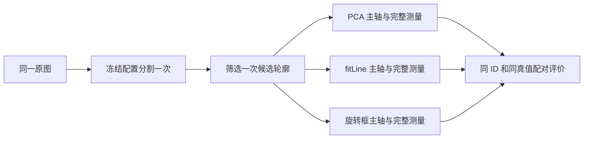

# PCA、fitLine 与旋转框：三种主轴的量化对比

2026-10-05 完成 **39 张合成图、16 张固定代表图及 4 张控制形状图** 的对照实验。每张图只分割和筛选一次，三种方法使用相同 mask、候选轮廓和原始灰度，分别重新计算尺寸。本次保留原算法、默认参数、质量规则及正式 JSON。

在这组代表图的 87 个共同匹配、非近圆目标上，PCA／fitLine／旋转框的平均无向方向误差为 **0.7926°／1.0033°／5.6209°**。这支持当前场景继续采用 PCA；尺寸结果没有一种方法处处占优，不能据此宣称 PCA 普遍最优。没有重跑 384 张全量三方法比较，也没有实物尺寸精度结论。

相关资料：[算法与计算](../README.md#pca-axis)、[观察宽度剖面与梯度](diagnostics.md)、[面试问答](interview.md)、[下一步路线](roadmap.md)、[2026-10-03 历史验证](validation.md)。以下保留关键表格，不依赖本地忽略的结果目录才能阅读。

## 目录

- [实验怎样保证可比](#protocol)
- [方向误差与样本范围](#direction)
- [尺寸误差与重复性](#dimensions)
- [覆盖率与失败数量](#coverage)
- [失败案例与适用范围](#failures)
- [实现、运行与产物](#implementation)
- [验证范围与面试讲法](#verification)

<a id="protocol"></a>

## 实验怎样保证可比



只改变 `Config::axis`，不改分割、形态学、头杆阈值或亚像素参数。测量原点都是轮廓矩质心，旋转框也相同；主轴改变后，投影、旋转后的局部 mask、宽度剖面、头杆判断和灰度采样都重新计算。仅替换 JSON 的角度不足以检验方向对尺寸的影响。

| 数据组 | 输入与配置 | 真值与评价用途 |
| --- | --- | --- |
| 正常合成 | [生成器](../tests/generate_samples.cpp) 产生的 39 张；[synthetic.yaml](../config/synthetic.yaml) 的 Otsu 配置 | 尺寸用 `truth.csv` 的连续几何名义值，方向用 [synthetic_axes.csv](../config/synthetic_axes.csv)；评价方向、像素尺寸和模拟重复波动 |
| 真实代表 | [冻结名单](../config/representative.txt) 中的 16 张；[measurement.yaml](../config/measurement.yaml) 的 Lab 配置 | MVTec 原始旋转框标注；评价匹配后的无向主轴，不能评价实物毫米精度 |
| 控制形状 | [控制图生成器](../tests/generate_axis_cases.cpp) 的近圆、极宽头、粘连、遮挡；使用合成配置 | 检查机制和质量规则，不混入正常尺寸误差统计 |

真实图沿用现有评价：`rotatedIoU >= 0.5`，按 IoU 降序贪心一对一匹配；标注框长宽比 `<1.3` 时排除方向误差。三个方案的预测框相同，所以匹配对也应相同。脚本会检查图像清单、候选数量、编号、质心、框、比较角度、非 axis 参数及匹配对；不满足就报错。

方向误差按 180° 周期计算，图像 y 轴向下，正角在图中为顺时针：

```text
d = |预测角 − 真值角| mod 180°
eθ = min(d, 180° − d)
```

例如 179° 与 1° 的误差为 2°。合成真值是生成多边形的杆部构造方向；真实真值是标注框长边方向，两者定义需分别理解。角度均为无向主轴，不能作为头尾准确率。

每项报告两种样本口径：**自身有效样本**是该方法能够参与统计的样本；**公共有效样本**是三方法均有效的交集。缺失、不可靠或处理失败不填零。方向先列出所有检出／匹配的可定义角度，再单列可靠样本；尺寸沿用项目评价规则，排除 `reliable=false`。同时列出失败数量，不能通过删掉困难样本获得较低平均误差。

代表图参与过 Lab 参数选择，不是独立留出集。39 张合成图中有 30 张来自同一个 17° 构造形状加模拟噪声，因此另外按生成条件拆分方向结果。

<a id="direction"></a>

## 方向误差与样本范围

单位：度；表中 N 是公共有效样本数，本次对应各方法自身有效 N 也相同。

| 样本范围 | N | PCA 平均 / 最大 | fitLine 平均 / 最大 | 旋转框平均 / 最大 |
| --- | ---: | ---: | ---: | ---: |
| 合成检出目标 | 39 | 0.0126 / 0.0288 | 0.0353 / 0.0821 | 0.1379 / 0.3008 |
| 合成可靠目标 | 39 | 0.0126 / 0.0288 | 0.0353 / 0.0821 | 0.1379 / 0.3008 |
| 真实匹配且真值非近圆 | 87 | 0.7926 / 8.6975 | 1.0033 / 17.6417 | 5.6209 / 22.1900 |
| 真实可靠匹配且真值非近圆 | 79 | 0.8160 / 8.6975 | 1.0543 / 17.6417 | 5.8904 / 22.1900 |

真实图共有 180 个真值，三方法均为 TP=144、FP=30、FN=36，召回 80.00%、精确率 82.76%。144 个匹配中有 57 个真值近圆，剩余 87 个进入方向统计；漏检 36 个没有预测方向，不参与平均值。再筛可靠目标得到 79 个。可靠子集均值略高，并不矛盾：几何可靠性是基于碰边、形状和剖面的规则，不是依据真值角度筛选。

| 合成生成条件 | N | PCA 平均 | fitLine 平均 | 旋转框平均 |
| --- | ---: | ---: | ---: | ---: |
| 六种旋转 | 6 | 0.0111 | 0.0241 | 0.0225 |
| 较小规格 | 1 | 0.0041 | 0.0086 | 0.2011 |
| 高斯模糊 | 1 | 0.0164 | 0.0209 | 0.2011 |
| 低对比度 | 1 | 0.0200 | 0.0821 | 0.0080 |
| 模拟噪声重复 | 30 | 0.0129 | 0.0374 | 0.1611 |

低对比度单例中旋转框误差更小；六种干净旋转中旋转框与 fitLine 也很接近。单例不构成鲁棒性实验，但足以说明不能把总体平均排序推广到每种条件。

真实最差公共案例为 `screws_169.png` 的候选 ID 2：PCA 8.6975°、fitLine 17.6417°、旋转框 22.1900°。可以从该案例检查 mask 外形、轮廓端部和极端边界对三个方向的影响；不把未人工确认的图像直接标为某种故障类型。自动报告列出误差最大的十个案例及并排图链接。

<a id="dimensions"></a>

## 尺寸误差与重复性

以下是 39 个共同可靠且可测样本的 MAE，单位 px。`width` 为整体横向投影范围，`shaft_width` 为接受杆段截面的宽度中位数；不是实物圆柱直径或螺纹小径。

| 尺寸 | 像素 PCA | 像素 fitLine | 像素旋转框 | 逐项优选 PCA | 逐项优选 fitLine | 逐项优选旋转框 |
| --- | ---: | ---: | ---: | ---: | ---: | ---: |
| 总长 | 0.2645 | 0.2633 | 0.2662 | 0.2476 | 0.2496 | 0.2551 |
| 整体宽度 | 0.2850 | 0.2840 | 0.2674 | 0.2823 | 0.2814 | 0.2992 |
| 头长 | 0.9744 | 0.9744 | 0.9744 | 0.9744 | 0.9744 | 0.9744 |
| 头宽 | 0.2850 | 0.2840 | 0.2674 | 0.2844 | 0.2792 | 0.3173 |
| 杆宽 | 0.9359 | 0.9231 | 0.9231 | 0.1030 | 0.1028 | 0.1119 |

逐项优选即 `preferred_px`：该项有亚像素值则采用，否则回退到像素值。本组合成图四个可细化尺寸都获得亚像素值，因此其优选结果与亚像素结果相同。**头长没有亚像素实现**，该项亚像素有效 N=0，优选沿用像素剖面结果，不能把缺失写成 0 px 误差。

方向更准不意味着每一项尺寸误差更小。方向、整数栅格旋转、剖面中位数、选取的截面和灰度细化共同影响结果；这组形状中，PCA 的优选总长误差较低，fitLine 的头宽和杆宽略低。差值很小，未做显著性检验，也不构成新的实物精度保证。旋转框整体宽度由 0.2674 增至 0.2992 px，也说明细化不保证每项改善。

30 张模拟噪声重复的优选总长标准差为 PCA **0.031709 px**、fitLine **0.026346 px**、旋转框 **0.043723 px**，均使用样本标准差（分母 N−1）。fitLine 波动较小，但波动与准确度是不同指标。头长标准差为 0，是离散剖面分界在这些扰动下没变，不代表实物头长无误差。该实验没有重新拍摄或重新摆放工件，不是工业 GR&R。

自动 `summary.json` 保留每项的有符号均值、MAE、最大绝对误差、标准差、自身／公共 N，以及 `missing_result`、`processing_error`、`missing_target`、`unreliable_geometry`、`unavailable_dimension` 的排除数量。

<a id="coverage"></a>

## 覆盖率与失败数量

正式合成和真实图中均没有图像处理失败。以下真实分母为 **全部 174 个候选**，包含误检与近圆目标，不只包含匹配螺钉。

| 方法 | 可靠 / 不可靠 | 可靠比例 | 整体 refined / fallback | 总长单项细化可用 | 头杆三个尺寸缺失 |
| --- | ---: | ---: | ---: | ---: | ---: |
| PCA | 100 / 74 | 57.47% | 58 / 116 | 58 / 174（33.33%） | 各 131 / 174 |
| fitLine | 100 / 74 | 57.47% | 60 / 114 | 60 / 174（34.48%） | 各 133 / 174 |
| 旋转框 | 100 / 74 | 57.47% | 57 / 117 | 57 / 174（32.76%） | 各 129 / 174 |

三种方法都使用 PCA 特征值比作初始方向质量检查，碰边和凸包占比也相同；后续剖面质量仍可能因方向而改变。头杆缺失不一定把 `reliable` 置 false，得到总长和宽度不代表头杆可测。

`refined` 是整体细化状态，不能替代每项覆盖率；有不可靠候选也可能得到细化值。仅在可靠候选中，总长细化可用分别为 37／41／34 个。所有候选的头宽细化可用分别为 23／25／22 个，杆宽为 24／25／22 个。头长细化始终缺失。覆盖率更高也不证明精度更高，真实图缺少这些尺寸真值。

<a id="failures"></a>

## 失败案例与适用范围

控制图只说明当前规则的行为；它们不是工业故障的充分覆盖。三种方案对相同候选输出 5 个对象：遮挡图被分成两个轮廓，其余各一个。图像处理成功与测量可信是不同概念，5 个对象均为 `refined` 仍可能不可靠。

| 控制案例 | 当前结果 | 学习要点 |
| --- | --- | --- |
| 近圆 | PCA 90°、fitLine 0°、旋转框 45°，均 `axis_ambiguous`、不可靠，头杆缺失 | 对称区域没有唯一长轴；不比较这些角度谁更准，也不凭输出了数值确认方向 |
| 极宽头部 | 构造杆轴 17°，头宽 280 px、总长 200 px；三方法主轴约 107°，均 `possible_touching`、不可靠，头杆缺失 | 外形最主要延伸方向已变成头部横向，三种整体几何方法都可能不等于杆轴；不能靠换 PCA／fitLine 修复形状定义 |
| 附加矩形粘连 | 构造螺钉轴 0°；PCA 5.6594°、fitLine 5.3570°、旋转框 3.3665° | PCA／fitLine 记录 `possible_touching_two_ends` 并拒绝可靠测量；旋转框仍 `reliable=true`、头杆缺失，当前质量规则有漏过粘连的范围 |
| 遮挡条带 | 原构造杆轴 17°，候选分成两段；第一段不可靠，第二段三方法均可靠但头杆缺失 | 片段可能仍细长、凸包占比正常；规则不能确认工件完整，不能把片段总长当成遮挡前真值 |

复盘时先看共享 mask 和轮廓，再看并排图、质量原因及缺失尺寸。若要深入剖面，可将控制图交给 [inspect_measurement](diagnostics.md#run) 使用同一配置观察；头部方向与统一导出字段仍属下一阶段。

<a id="implementation"></a>

## 实现、运行与产物

新增 [compare_axes.cpp](../src/compare_axes.cpp) 为无窗口批量入口，[compare_axes.py](../tools/compare_axes.py) 为标准库实验编排与统计入口。新增 [measureContours](../include/screw/pipeline.hpp) 接收已筛好的轮廓，复用正式入口的定位、测量、尺度／配方、排序与编号逻辑。原 `measureObjects` 接口及诊断旁路保留。

从项目根目录运行，先取得真实数据；输出目录必须为空，复跑使用新目录，保留历史报告：

```sh
cmake -S . -B build
cmake --build build -j 4
ctest --test-dir build --output-on-failure
python3 tools/compare_axes.py --output result/axis_comparison
```

脚本默认读取 `data/synthetic`；若缺少合成真值文件，在本次输出目录内生成 39 张合成图，不覆盖已有数据。真实数据获取方式见 [README](../README.md#dataset)。需要改变路径时使用 `--build-dir`、`--dataset`、`--synthetic`、`--output`。

也可以只比较一个图或一个目录，最后一个参数是可选的冻结图像名单，每行一个不含目录的文件名：

```sh
build/compare_axes data/synthetic/images config/synthetic.yaml result/axes_synthetic
build/compare_axes data/mvtec_screws/images config/measurement.yaml \
  result/axes_real config/representative.txt
```

单独 C++ 入口仅保存三种测量结果；完整评价与学习报告由 Python 入口串联既有 `screw_metrology evaluate` 完成。

```text
输出目录/
  report.md                         表格、误差最大案例及控制形状结果
  summary.json                      误差、交集、覆盖率、原因与重复性
  provenance.json                   UTC 时间及源码/程序/配置/真值/原图 SHA-256
  synthetic_angles.csv              合成逐目标方向误差
  representative_angles.csv         真实逐匹配目标方向误差
  inputs/stress/                    本次控制图与构造说明
  synthetic/、representative/、stress/
    metadata.json、manifest.jsonl   OpenCV 版本、图像清单、候选数与异常
    shared/                         每图唯一 mask 与原图坐标轮廓点
    methods/pca/、fitline/、rect/    原尺寸叠加图及正式 schema JSON
    panels/                         三方法并排图（仅显示时缩放）
    evaluation/                     合成及真实的三方法原评价报告
```

本次最终本地产物目录为 `result/axis_comparison/`，属于可再生成产物，不作为仓库必须携带的图片资源。`provenance.json` 包含未提交源码和实际程序的内容哈希，避免只凭 Git HEAD 判断使用了哪份实现。图像解码失败会为每个方法保存错误 JSON、写入清单并返回非零；汇总不会把失败当成功。

<a id="verification"></a>

## 验证范围与面试讲法

验证环境：2026-10-05，macOS arm64、AppleClang 21、C++17、OpenCV **5.0.0**。本报告不比较算法速度：当前 `locate` 每次会计算全部三种方向，完整运行还包含图像写盘，并不等于三种主轴算法各自的纯计算耗时。

- 构建全部目标，CTest **12/12 通过**；Python 统计和错误路径测试使用标准库，通过 CMake 检测到的 Python3 运行。
- 共享轮廓入口与原入口的 JSON、编号、质量和配方判定一致；候选不被测量修改，空输入及截断拒绝路径通过。
- 统计测试覆盖周期角度、公共样本交集、缺失／不可靠排除、近圆与可靠方向分开、坏图错误记录、非空目录保护和重名输出拒绝。
- 原流程回归的 303 份 JSON／JSONL（729 行逐项记录）完全一致，仅排除批次耗时；解码后 668 张 mask／叠加图也与基线一致。
- 新对比入口的 16 张真实图 × 3 方法，共 48 份 JSON 的全部对象字段与原入口一致；检查了无窗口保存的并排图。

这轮验证未运行图形窗口交互、OpenCV 4 构建、384 张全量三方法比较或实物重复采集。当前可用的面试表述：

> 我固定每张图的 mask 和候选，只切换主轴并重新跑尺寸测量。在 16 张代表图的 87 个匹配、非近圆目标上，PCA 平均方向误差约 0.79°，fitLine 约 1.00°，旋转框约 5.62°，所以目前保留 PCA。合成图上我又比较了尺寸误差和公共可测样本，发现方向更准不保证每项尺寸最好。我也检查了近圆、宽头、粘连和遮挡，发现整体外形轴可能不等于杆轴，质量规则还会漏过部分片段；这些是已确认的限制，后续需要单独改进和验证。

下一步按 [路线第三阶段](roadmap.md#head-tail) 明确导出头部端、分界和有向角，并以人工标注验证；本轮只补齐对比证据，没有借此调整阈值或改变算法。
