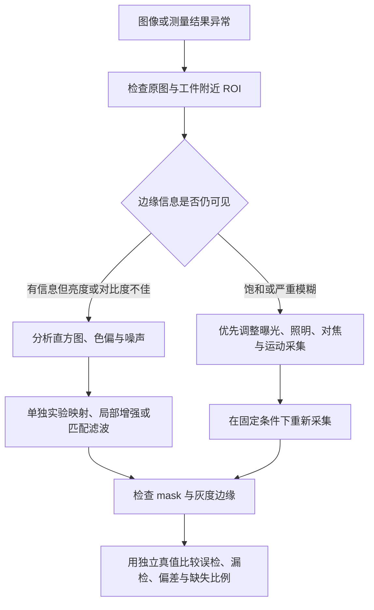

# 螺钉视觉测量项目：面试介绍、追问与成像排查

面向工业视觉／图像算法岗位。先读 [README 的计算实现](../README.md#learning-flow)，再练习把实现说清楚。本文中的第一人称是可改写的话术模板，只保留自己实际参与、能解释和能复现的内容，不把建议方案描述成已完成工作。

## 导航

- [项目介绍：30 秒、2～3 分钟与简历](#pitch)
- [面试中可以引用的证据](#evidence)
- [分割与候选：问题 1～7](#segmentation-questions)
- [方向与头尾：问题 8～15](#geometry-questions)
- [测量与评价：问题 16～22](#measurement-questions)
- [工程与改进：问题 23～28](#engineering-questions)
- [成像与预处理专题](#preprocessing)
- [独立 C++ 教学示例](#preprocessing-example)
- [面试前复盘清单与原理来源](#review)

<a id="pitch"></a>

## 1. 怎样介绍这个项目

### 30 秒简介

> 我做的是一个 C++／OpenCV 的离线螺钉定位与外形尺寸测量项目。针对偏黄木纹背景，我比较了 Otsu、自适应阈值和 Lab，选择颜色与暗部条件结合的 Lab 分割。再用填充区域 PCA 求主轴，建立局部坐标，通过投影和宽度剖面测量总长、头部和杆部，并尝试灰度亚像素细化。项目记录测量失败原因，支持尺度换算和公差判定；真实数据验证定位，合成真值验证尺寸链路。

### 2～3 分钟完整讲述

> 这个项目解决的是“工件在哪里、沿什么方向测量、哪些尺寸可测、结果能否判定”四个问题。输入是离线彩色图，输出 mask、叠加图和带质量原因的 JSON。目前以公开数据验证，还没有宣称产线部署或实物毫米精度。
>
> 第一个难点是木纹和金属的亮度交叠。Otsu 只看全局灰度，自适应阈值又容易响应木纹的局部明暗。我的默认方案在轻度平滑后转换到 Lab，用 b 通道保留相对不黄的区域，再用 L 条件补暗金属，两者取并集。固定 16 张代表图、统一冻结配置的比较中，Lab 检出率是 80%，精确率约 82.76%。这支持当前场景选型，不代表各方法独立调优后 Lab 一定最好。
>
> 第二个难点是倾斜目标的尺寸定义。我填充当前外轮廓，对内部像素做 PCA，以最大方差方向建立工件坐标。总长和整体宽度是轮廓在两轴上的投影范围。PCA 本身没有头尾，所以再旋转当前工件掩膜，建立逐列宽度剖面，通过只有一端明显扩大和连续变窄的位置找到头部及头杆分界。当前没有导出统一的头尾方向角。
>
> 第三个难点是避免把“有数值”当成“可信”。亚像素阶段回到原始灰度图，用梯度峰和三点抛物线拟合修正边缘，弱峰、多峰或有效截面不足就回退。碰边、疑似粘连或方向不明确会标记几何不可靠；即使有尺寸，也不据此给出可靠公差结论。
>
> 验证方面，2026 年 10 月 3 日的全量报告处理了 384 张真实图，定位检出率 84.55%、精确率 83.31%；匹配且非近圆目标的主轴平均误差为 0.88°。尺寸用 39 张合成图验证，其中杆宽 MAE 从像素结果约 0.936 px 改善到细化结果约 0.103 px。下一步应先做真实固定成像、实物标定和尺寸真值采集，再验证反光与重复性，而不是直接把合成误差当作实物精度。

讲述顺序保持“问题 → 选择 → 计算 → 验证 → 限制”。被追问时展开对应模块，不一次报完所有参数。如果面试官只给一分钟，保留木纹分割、PCA 与头尾区别、可信度检查三个点。

### 可调整的简历描述

- 基于 C++17／OpenCV 实现离线螺钉定位与外形测量，完成 Lab 分割、区域 PCA、局部投影、头杆剖面和灰度亚像素细化，输出尺寸及可解释的质量原因。
- 在固定配置下完成 MVTec Screws 384 张图的定位复现，检出率 84.55%、精确率 83.31%；基于合成真值比较像素／亚像素尺寸误差，并验证尺度换算、公差与关键失败路径。

可以按自己的职责删减，但不要改成“十三类识别准确率 84.55%”“毫米精度 0.01 mm”“已经通过工业 GR&R”或“头尾准确率 99%”：当前证据不支持这些表述。

<a id="evidence"></a>

## 2. 哪些内容已实现、已验证、仍是建议

以下历史结果来自 [2026-10-03 验证记录](validation.md) 和 [机器可读汇总](validation_summary.json)；新增三主轴对照来自 [2026-10-05 量化报告](axis_comparison.md)。环境均为 macOS arm64、AppleClang 21、C++17、OpenCV 5.0.0。

| 层次 | 能说的事实 | 应同时说明的边界 |
| --- | --- | --- |
| 已实现 | 三种分割、三种主轴、宽度剖面、亚像素、尺度、公差、JSON 和质量原因 | 没有自动规格识别、通用粘连分离、遮挡恢复、畸变／透视矫正 |
| 代表样例对比 | 16 张、180 个真值；Lab 的召回／精确率 80.00%／82.76% | Lab 参数按代表样例选择，统一冻结配置；不是独立测试集或独立调优对比 |
| 真实全量定位 | 384 张、4427 条包内标注；TP=3743、FP=750、FN=684 | 评价是旋转框匹配，包括几何不可靠预测，不是尺寸合格率 |
| 真实方向 | 2226 个匹配且非近圆目标，平均误差 0.88° | 是无向主轴误差；不包含漏检方向，没有三方法全量对比 |
| 三主轴对照（2026-10-05） | 16 张固定代表图，87 个公共匹配非近圆目标；PCA／fitLine／旋转框平均误差 0.7926°／1.0033°／5.6209° | 固定 mask 和候选，重新测量；另有 39 张合成尺寸对照及 4 个控制案例，尚非全量比较或实物精度 |
| 合成尺寸 | 39 张、195 条尺寸记录；杆宽 MAE 0.9359→0.1030 px | 总长、整体宽度和头宽改善较小；头长没有亚像素结果 |
| 模拟重复性 | 30 次模拟噪声重复，长度样本标准差 0.031709 px | 不是相机、装夹和操作者的实物重复性 |
| 运行时间 | Debug、单线程、含图像／JSON 写盘，全量测量约 53.8 秒 | 仅该环境和该批次；未建立纯算法实时性能指标 |
| 后续建议 | 固定成像、曝光诊断、CLAHE 实验、实物真值、性能剖析 | 当前没有这些成像补偿模块，不放进“已实现”清单 |

官方页面标注数量与下载包有差异，项目保留记录，按包内 4427 条唯一标注评价。代表样例也包含在全量数据中。面试报数字时先说评价对象，再说指标，不省略统计范围。

<a id="segmentation-questions"></a>

## 3. 分割与候选：问题 1～7

### 1. 项目的输入输出是什么？为什么不用一个检测框直接完成测量？

**口述回答：** 输入是离线 BGR 图，输出工件轮廓、方向、投影尺寸和质量原因。检测框可以定位，但尺寸必须有明确方向和边界定义，所以还需要轮廓、局部坐标与灰度边缘。

**原理展开：** 核心链路是 `segment → measureObjects`；共享函数内部依次执行 `candidates → locate → measureObject → applyScaleAndRecipe`，最后按质心排序编号，正式入口与实验入口共用。旋转框用于展示和定位评价；实际整体尺寸沿选中主轴对轮廓重新投影。像素、细化、毫米三组结果分别保留，便于解释误差与回退。

**常见追问：** 测的是外形投影还是实际直径？答：外形投影，不直接等于三维圆柱直径或螺纹小径。

### 2. 为什么默认用 Lab？

**口述回答：** 当前背景偏黄，部分金属更接近中性，颜色能提供灰度之外的区分信息。我用 b 条件保留相对不黄区域，L 条件补暗金属，并通过固定代表样例对比选择默认方案。

**原理展开：** 当前条件是 `b8<=145 || L8<=90`。对 16 张代表样例，仅切换分割方法时，Lab 召回／精确率为 80.00%／82.76%，Otsu 为 21.67%／8.11%，自适应为 2.22%／0.95%。暗木纹也可能满足 L 条件，规则并没有从原理上消除所有背景。

**常见追问：** 换成白色背景还用这个参数吗？答：先重新观察通道分布；干净灰度背景可能更适合 Otsu，固定阈值不是通用模型。

### 3. Lab 的 b=145 是什么含义？为什么用 OR？

**口述回答：** 145 是 OpenCV 8 位 b 编码，中性值约为 128，不能当成浮点 Lab 的 145。OR 是把颜色条件与暗部条件并起来，分别补足亮金属和偏暖暗面。

**原理展开：** `L8≈L*×255/100`、`a8≈a*+128`、`b8≈b*+128`，145 约对应 b*=17。矩阵比较得到 0/255，再按位或形成 mask；AND 会要求同时满足两个条件，减少候选但可能漏掉工件。当前不用 a，不意味着 a 在其他场景无用。[编码关系见 OpenCV 文档](https://docs.opencv.org/4.13.0/de/d25/imgproc_color_conversions.html)。

**常见追问：** Lab 是否不受光照影响？答：不是；亮度与色度分开表达也不等于不受曝光、白平衡或光谱影响。

### 4. Otsu 和自适应阈值分别怎么计算？

**口述回答：** Otsu 根据整图灰度分布最大化类间方差，求一个阈值；自适应为不同位置用局部加权均值减 C 求阈值。一个看全局，一个看局部，但都没有工件语义。

**原理展开：** Otsu 目标为 `ω₀ω₁(μ₀−μ₁)²` 最大，较适合可分离的两类亮度。当前自适应采用高斯局部均值，窗口 51×51、C=8，反向二值化选择暗部。窗口很小可能追随纹理，太大又近似全局统计。两者分别调优的公平比较需要单独预算和留出验证。

**常见追问：** 自适应适合光照不均，为什么本项目更差？答：木纹也产生局部变化；算法适合一种干扰不意味着能区分目标与纹理。

### 5. 高斯、开运算、闭运算分别解决什么？

**口述回答：** 高斯减少分割噪声，开运算去掉小白点，闭运算补小裂缝。它们都可能改变边界，所以核大小要同时看检出和尺寸偏差。

**原理展开：** 默认高斯 3×3、椭圆开运算 3×3、闭运算 11×11；开是腐蚀后膨胀，闭是膨胀后腐蚀。大开核会削掉细杆或尖端，大闭核会连上邻近工件。分割使用平滑图，细化使用原始灰度，避免重复模糊测量信号。

**常见追问：** 闭运算补出了边缘，为什么还会有尺寸误差？答：它基于结构元素修补形状，不知道真实边缘，后续灰度搜索也不保证能纠正过大的偏移。

### 6. 连通域与 findContours 有什么区别？

**口述回答：** 连通域把相连的白色像素分组并统计像素面积；轮廓提取把区域变成边界点，供几何计算。本项目先过滤连通域，再提取外轮廓并筛选。

**原理展开：** 8 邻域接受对角连接。`RETR_EXTERNAL` 不提取内部孔洞，`CHAIN_APPROX_NONE` 保留完整边界点。白色像素数与轮廓围成的几何面积不同，带孔时差别更明显。候选还检查轮廓点数、几何面积与凸包占比。

**常见追问：** 两个相接物体能获得两个轮廓吗？答：当前流程通常获得合并外轮廓，没有通用实例拆分。

### 7. solidity、质心和旋转框中心分别是什么？

**口述回答：** solidity 是轮廓面积除以凸包面积，反映凹陷程度；质心来自轮廓矩，旋转框中心来自最小包围框，两种中心不是一个定义。

**原理展开：** 质心为 `(m10/m00,m01/m00)`，大头部会影响面积分布。候选门槛默认 `solidity>=0.25`，保留后若低于 0.55 又标记疑似粘连并置不可靠。这两道门槛分别服务于候选显示和可靠判定，不能合并解释。

**常见追问：** 凹陷是否一定是粘连？答：不是，可能是正常形状或分割错误，因此记录为启发式疑似原因。

<a id="geometry-questions"></a>

## 4. 方向与头尾：问题 8～15

### 8. PCA 怎么求方向？样本是什么？

**口述回答：** 我填充当前外轮廓，用内部全部白色像素的二维坐标做 PCA，求协方差最大特征值对应的特征向量，作为主要延伸方向。

**原理展开：** 对 N×2 点矩阵按行采样，中心化后求 `C=(1/N)Σ(P_i−μ)(P_i−μ)^T`；主轴角度是 `atan2(v_y,v_x)`。在包围 ROI 内计算不影响方向，因为平移不改变协方差。本项目用填充区域，内孔也填满，与只采样边界的 PCA 不同。[OpenCV PCA 教程](https://docs.opencv.org/4.13.0/d1/dee/tutorial_introduction_to_pca.html)可用于理解基础步骤。

**常见追问：** PCA 均值就是你输出的 center 吗？答：输出 center 是轮廓矩面积质心，PCA 内部用像素样本均值，两者可以略有不同。

### 9. 为什么不直接用 minAreaRect 或 fitLine？

**口述回答：** 三种方法都实现并记录了角度。区域 PCA 基于整个面积分布，并提供特征值比；旋转框依赖外形极值，fitLine 则受轮廓采样分布影响，各有优缺点。

**原理展开：** `minAreaRect` 选择长边方向，height 更长时补 90°。当前 `fitLine` 使用 `DIST_L2` 拟合轮廓，不是 RANSAC。2026-10-05 我固定 mask 和候选，在 16 张代表图的 87 个匹配非近圆目标上，比较得到平均方向误差约 0.79°／1.00°／5.62°，支持这组数据保留 PCA；39 张合成图又比较了最终尺寸，发现 fitLine 的杆宽 MAE 与 PCA 很接近，不能说每项都是 PCA 最好。极宽头部案例中三种整体外形方向都转到头部横向，遮挡片段也可能仍通过质量检查。详见 [量化对比与失败范围](axis_comparison.md)。历史 0.88° 仍是 PCA 全量报告结果，不与这次代表图数字混用；尚未完成三方法全量比较。

**常见追问：** 怎么证明选得对？答：同 mask、同匹配目标、同无向误差口径，分别重跑尺寸；既报告公共有效样本误差，也报告每种方法失败与缺失数量。当前代表图上 PCA 平均方向误差较小，但参数选择样例不是独立测试集，真实框标注也不能证明毫米尺寸精度。

### 10. 特征值比有什么作用？圆形目标怎么办？

**口述回答：** 两个特征值接近时，形状没有明显长轴，计算出一个角度也不代表可靠。比值低于 1.3 就标记方向不明确，保留展示结果但禁止可靠公差判定。

**原理展开：** 使用 `λ₁/max(1e−9,λ₂)` 防止除零；哪怕选 fitLine 或 rect，仍使用 PCA 的比值检查几何方向。接近圆形的螺母可能有整体长宽，但头杆字段缺失。降低门槛只是放宽检查，不会创造真实方向信息。

**常见追问：** 大头螺钉或遮挡会怎么样？答：都会改变面积分布和宽度剖面，应检查形状与误差；特征值比不是万能正确性证明。

### 11. 为什么建立局部坐标？角度误差怎么比较？

**口述回答：** 让坐标轴跟随工件，避免倾斜时水平包围框把长度和宽度混在一起。角度是无向轴，按 180° 周期比较。

**原理展开：** `s=(P−O)·e_x`、`t=(P−O)·e_y`，逆变换 `P=O+s e_x+t e_y`。图像 y 向下，正角度在显示上顺时针。179° 与 1° 的误差是 2°，不是 178°；二维主轴也不是三维位姿。

**常见追问：** 旋转 mask 是不是重新旋转原图来测灰度？答：只旋转候选二值填充图用于剖面；灰度采样映射回原图。

### 12. 总长、整体宽度、头宽和杆宽如何定义？

**口述回答：** 总长和整体宽度分别是全轮廓两轴的投影范围；头宽只看头侧轮廓，杆宽是接受杆段截面的中位数，不能互相替代。

**原理展开：** 整体 t 极值可能来自不同截面，不等于某一列最大宽度。边界像素中心距离不统一加 1；头长是头端至剖面分界的 s 距离。杆宽排除头部及两端过渡区，并取原始截面中位数，而不是直接用平滑基线。

**常见追问：** 螺纹小径能测吗？答：当前测外轮廓投影，不做螺纹牙底识别。

### 13. PCA 能区分头尾吗？项目怎么判别？

**口述回答：** PCA 只能给轴线，向量反号仍是同一方向。我再利用宽度剖面，只有一端明显比杆部宽时，把这一端识别为头部。

**原理展开：** 填充候选并最近邻旋转，逐列找上下边界，得到 `width(s)`；用 5 点窗口中位数平滑。中间 30%～70% 估计杆宽，两端靠内 5%～20% 比较是否超过 `1.25*shaft`。这些比例按有效截面索引计算。内部 `head_end=-1/+1` 表示局部负／正端，输出角度仍没有统一为头指向尾。

**常见追问：** JSON 能直接拿到头尾角吗？答：不能；`head_end` 是测量模块内部阶段结构的成员，`head_boundary` 用于绘图但也未导出到正式 JSON，没有独立尖端检测。新增学习入口可以用过程面板和 CSV 观察它们，见 [中间过程案例](diagnostics.md)。

### 14. 如何确定头杆分界？为什么要求连续 3 个截面？

**口述回答：** 从识别的头侧向内扫描，连续 3 个截面回到杆宽阈值内才确认，减少螺纹、凹口或单点波动造成的误判。

**原理展开：** 只对杆宽大于 2 px、总长大于整体宽度 1.5 倍且长轴明确的目标尝试。扫描不超过约半个剖面，超过约 5% 后才接受连续窄段，并回取 3 个点的第一个。若杆宽 20、阈值 25，索引 30～32 连续不大于 25，负端分界就是 30；若 smin=−100、分界 s=−70，则头长 30 px。

**常见追问：** 连续点数和阈值是理论保证吗？答：是当前启发式参数和规则，需要针对形状及分辨率验证。

### 15. 粘连、两头都宽或没有头杆差异怎么办？

**口述回答：** 不强行给出头杆尺寸。记录缺失或疑似粘连，必要时标记几何不可靠，继续保留可见整体尺寸供排查。

**原理展开：** 两端扩大检查包含较低四分位宽度基线，中段持续异常变宽也会标记。正常剖面找不到分界记录 `head_shaft_unavailable`；少于 10 个有效截面更早返回。既没有通用分水岭分离，也没有遮挡恢复。未来可尝试实例分割，但被遮住的尺寸仍需要模型假设或其他视角。

**常见追问：** 分水岭一定能把重叠螺钉分开吗？答：依赖可分离形状和可靠标记，交叉遮挡不保证解决，也不能恢复真实隐藏边界。

<a id="measurement-questions"></a>

## 5. 测量与评价：问题 16～22

### 16. 什么是亚像素？为什么不用二值图细化？

**口述回答：** 亚像素是在灰度边缘模型下估计小数像素位置，不是提高图像真实分辨率。二值 mask 已丢掉亮度过渡，所以细化回到原始灰度。

**原理展开：** 以粗边缘为起点沿测量方向取样，双线性插值访问非整数位置，计算中心差分梯度幅值。总长沿主轴，宽度沿横向，任意弯曲边界上不保证是真实法线。误分割、反光和搜索范围仍然限制细化。

**常见追问：** 插值能恢复真实细节吗？答：它是对已有像素的模型估计，不能恢复饱和或不可见的信息。

### 17. 抛物线拟合公式和尺寸修正公式是什么？

**口述回答：** 对梯度峰及左右点拟合抛物线求小数偏移；两端都沿同一方向采样，所以尺寸加末端偏移、减起点偏移。

**原理展开：** `δ=0.5*(g_-−g_+)/(g_-−2g_0+g_+)`，曲率须为负且偏移受限。`d_refined=d_pixel+offset_high−offset_low`；例如 `199+0.6−(−0.4)=200`。函数返回有符号偏移，不是绝对坐标，不能直接把两偏移相加。

**常见追问：** 为什么抛物线合理？答：把局部光滑峰近似为二次曲线；只在峰形和采样有效的条件下使用，不是所有反光边缘都符合模型。

### 18. 细化何时回退？能有一部分尺寸细化、一部分像素吗？

**口述回答：** 弱峰、多峰、越界或不稳定拟合会拒绝边缘；整体条件不足则回退，但各尺寸最终逐项优选，因此可以混合使用。

**原理展开：** 默认梯度门槛 5、搜索半径 4；距离超过 2 点的近等强局部峰会拒绝。整体要求总长两端有效、至少 60% 被尝试截面两侧成功，再单独检查整体宽度；整体失败会清空 refined。头宽可独立失败，头长始终仅像素，杆宽依赖有效杆段。`fallback` 本身不自动置几何不可靠。

**常见追问：** `refined` 状态是不是所有项都有小数结果？答：不是，要看每个 optional 字段，尤其头长仍缺失。

### 19. 像素怎么换成毫米？为何分辨率相同仍不够？

**口述回答：** 用已知参考长度除以两参考点的像素距离得到 mm/px，再乘测量值。尺度依赖固定拍摄距离、焦距、工件平面和近似正视，分辨率匹配只是一项必要检查。

**原理展开：** `scale=known_mm/norm(p2−p1)`，参考点必须在图内、间距至少 1 px。读尺度时重算以检查一致性。当前没有镜头畸变或透视校正；裁剪、缩放、改变高度后要重新确认适用性。合成尺度 0.1 mm/px 用于验证换算，不是实物标定成绩。

**常见追问：** 怎样验证实物毫米精度？答：固定成像、用合适标定与独立量具真值，评估不同位置、规格和重复采集的偏差及波动。

### 20. 为什么有尺寸还会 NOT_EVALUATED？

**口述回答：** 有可见尺寸不代表能给完整且可靠的公差结论。混料模式、无配方、几何不可靠、缺适用毫米尺度或必要尺寸缺失，都保持未判定。

**原理展开：** 每项优先使用有效 refined，否则 pixel；尺度换算可以先保留展示值。`single` 是使用者确认单规格，不是自动分类。范围包含上下限；全部必要项齐全且在范围内才 OK，齐全但有越界才 NG；同时有缺失和越界仍未判定，并记录原因。

**常见追问：** 为什么不把缺失当 NG？答：当前状态表示完整尺寸检验结论，测不出和明确超差分开；产线处置可另按业务规则转入复检或剔除。

### 21. 84.55% 和 0.88° 怎么算？会不会只挑成功样本？

**口述回答：** 定位按旋转框 IoU≥0.5、降序贪心一对一匹配，召回和精确率分别反映漏检与误检。角度只对成功匹配且非近圆目标计算，所以必须同时报告漏检数量和统计范围。

**原理展开：** TP=3743、FP=750、FN=684；召回 `3743/4427=84.55%`，精确率 `3743/4493=83.31%`。0.88° 覆盖 2226 个真值框长宽比至少 1.3 的匹配目标，按 180° 周期。框中心误差比较两边旋转框中心，不能叫质心定位真值误差。标注有 row/col、半像素原点和逆时针弧度转换。

**常见追问：** 是严格独立测试集吗？答：不是；代表样例参与选参并包含于全量数据，应如实说明，后续需要独立留出验证。

### 22. 如何证明尺寸和亚像素有用？重复性就是准确度吗？

**口述回答：** 通过已知几何合成图比较像素、细化和最终选择的误差，亚像素对杆宽改善明显，但其他项改善较小。重复性只反映波动，稳定也可能一直偏差。

**原理展开：** 39 张合成图覆盖旋转、规格、低对比度和模糊；杆宽 MAE 0.9359→0.1030 px，总长 0.2645→0.2476 px，头长仍约 0.9744 px。独立解析边缘真值 154.37 px 测试要求误差小于 0.15 px。30 次模拟噪声重复的长度标准差约 0.031709 px，不是实物 GR&R。

**常见追问：** 为什么细化没有让所有项大幅改善？答：不同尺寸的边界、栅格化和方向误差不同；头长依赖阈值分界，必须按项看数据。

<a id="engineering-questions"></a>

## 6. 工程与改进：问题 23～28

### 23. 代码怎么组织？缺失值与异常怎么处理？

**口述回答：** 核心分割、定位、测量、标定和评价分模块，命令行入口负责串联。optional 表示不可测，JSON 导出 null；批处理对坏图记录错误并继续。

**原理展开：** `screw_core` 被正式命令行和手动实验复用。配置验证方法名、核尺寸、数值范围和未知键，避免拼错后静默使用默认值。Object 分开保存质量问题和判定原因；单图异常清空部分目标结果。输出编号按每图位置重新生成，不是追踪 ID。

**常见追问：** 为什么不返回 0 尺寸？答：0 是数值，缺失是状态，混用会让尺度换算和公差判定产生假结论。

### 24. 性能如何？瓶颈和优化方向是什么？

**口述回答：** 已有报告是 2026-10-03 在 macOS arm64、AppleClang 21、OpenCV 5.0.0 下，Debug 单线程、含写盘的 384 图测量约 53.8 秒。还不能当作纯算法实时帧率。

**原理展开：** 可能开销包括整图分割、连通域、填充区域样本、逐列剖面、灰度采样与图像写盘。应先分阶段计时，再用 Release 区分算法和 I/O；ROI、缓存或批次并行要通过剖析决定。当前三种方向都计算，后续若减少计算需兼顾比较输出。以上是候选优化，没有已验证加速比例。

**常见追问：** 直接开多线程可以吗？答：要检查共享输出、命名冲突、内存与 OpenCV 内部线程，避免并行层数叠加；先测瓶颈。

### 25. 图像过灰、有噪声，为什么不直接 CLAHE 加锐化？

**口述回答：** 先区分低对比度、噪声和模糊。CLAHE 可能同时增强木纹和噪声，锐化可能产生额外梯度峰；好看不等于边缘更准确。

**原理展开：** 看 ROI 直方图、P95−P5、边缘两侧亮度差及扩散宽度，再选择拉伸、局部增强或匹配噪声的滤波。需要固定参数对比召回、误检、尺寸偏差和细化覆盖率，不能只看处理后图。当前项目只用了分割高斯平滑与形态学，尚无 CLAHE 或锐化模块。

**常见追问：** CLAHE 应该用哪个通道？答：灰度或亮度通道是候选；不要分别均衡 BGR 后假定原颜色规则仍有效。详见 [预处理专题](#preprocessing)。

### 26. 金属过曝反光怎么办？压暗图像能恢复吗？

**口述回答：** 偏亮但未饱和可以实验亮度映射，过曝饱和已截断细节，压暗只能把白块变暗。优先调整曝光和照明，让可测边缘重新出现。

**原理展开：** 检查工件 ROI 的高值比例、连片区域和各 BGR 通道是否截断，再看反光是否覆盖边缘。候选采集措施包括漫射、改变光源角度、固定曝光／增益，以及条件合适时评估偏振；对不同金属和光路需实测。可测量的前提不是没有亮点，而是边界和关键区域仍有信息。

**常见追问：** HDR 一定解决吗？答：多曝光融合有运动、配准和边缘一致性问题，测量用途需要重新验证，当前未实现。

### 27. 为什么用传统视觉，不直接深度学习？

**口述回答：** 当前场景有可利用的颜色和细长几何先验，传统方法便于解释与验证，且不需要训练。若背景和遮挡变化很大，可评估学习式分割，但检测好仍需几何测量和质量控制。

**原理展开：** 传统方法的代价是场景参数依赖，学习方案的代价包括标注、数据划分、域变化和部署。已有旋转框标注不等于像素级轮廓真值；用框训练检测也不自动获得精确测量边界。是否引入学习方法应看错误类型，而不是单看算法名称。

**常见追问：** 学习方法能恢复遮挡尺寸吗？答：可以估计，但估计依赖模型假设，与独立可测的真实尺寸不同，应有不确定性和验证。

### 28. 如果继续做，你先改什么？

**口述回答：** 先固定成像并建立实物尺寸真值，按漏检、误检、方向、头杆分界和灰度边缘分类排查，再决定预处理或分割改进。

**原理展开：** 可先建立独立验证集与曝光／色偏扰动实验；若需要头尾方向，增加明确端点和有向角接口及失败状态；若粘连占主要误差，再评估实例分离；若要上线，则补相机标定、重复采集、吞吐与复检流程。它们目前都是后续方向，不写成已实现能力。

**常见追问：** 怎样知道改进有效？答：保持输入划分和评价口径一致，同时比较检出、误检、各尺寸有符号偏差、MAE、缺失比例和重复性，不只比较平均方向误差。

<a id="preprocessing"></a>

## 7. 成像与预处理：先找原因，再选择处理

本节是面试知识与后续实验方案。当前代码没有 Gamma、CLAHE、自动曝光、白平衡、背景校正、去模糊或 HDR 模块，也没有相机控制接口。实际已用的是分割分支的高斯平滑、开闭运算，以及原始灰度测量。

### 7.1 通用诊断顺序



先看原始像素，不只看缩放显示。全图直方图可能被木纹背景主导，应同时分析工件和附近背景 ROI；不能为了诊断提前裁剪后，又直接沿用原图尺度或丢失坐标。

| 诊断量 | 想回答的问题 | 解释限制 |
| --- | --- | --- |
| 灰度均值、直方图与 P5/P50/P95 | 整体偏暗／偏亮？有效灰度分布是否集中？ | 平均值正常也可能有局部过曝 |
| `P95−P5` | 大部分像素的动态范围是否很窄？ | 不是工件与背景分离度，ROI 与噪声会影响数值 |
| 灰度及各 BGR 通道的高值比例 | 是否存在接近编码上限的区域？ | 250 是教学近上限阈值，不是统一的传感器饱和标准 |
| 边缘两侧亮度差和过渡宽度 | 边缘信号弱，还是模糊扩散了？ | 反光、纹理和压缩可能让单条剖面不代表整体 |
| 参考区域的 L/a/b 与帧间波动 | 白平衡、照明或噪声是否漂移？ | 要用同材质／同位置比较，不能拿不同零件混比 |

### 7.2 整体偏亮、过曝饱和与局部金属反光

**现象：** 图像整体发亮，或者金属上出现大片无层次的白块，mask 可能缺一段，也可能把亮背景一并接收。

**诊断：** 检查原图灰度及各 BGR 通道是否大量接近上限，是否形成覆盖关键边缘的连片区域。灰度未达 255 也可能有单通道截断。相机 RAW 和位深信息有助于判断；仅 JPEG 像素无法完整反推传感器曝光状态。

**采集端措施：** 固定适合场景的曝光和增益，降低过亮区域；改变光源位置／角度，评估大面积漫射照明。偏振是否有效取决于表面、光路与入射条件，需要实拍，不能保证所有金属都消除反光。缩短曝光时也检查暗部信噪比。

**软件候选：** 未截断时可实验 `I'=αI+β` 或 Gamma 压暗；有原始高位深数据时可评估映射。已饱和区域不靠压暗、均衡或 CLAHE 恢复真实细节。多曝光 HDR 属于新的采集与融合方案，还需运动配准和边缘一致性验证，当前未实现。

**对测量的影响：** 色度、L 条件和边缘梯度都可能变化。反光边缘可能比工件真实边缘更强，造成多峰或错误峰；靠闭运算填白块只是形状猜补，不能证明补回真实尺寸。

**验证：** 对同一实物固定位置拍摄不同曝光／照明条件，检查关键边缘是否恢复，再比较 mask 连续性、误检漏检、细化覆盖率和各项尺寸偏差。不能只统计白块减少。

### 7.3 偏暗、欠曝与增益噪声

**现象：** 灰度分布靠近低值，暗金属与阴影都接近黑，边缘弱，可能触发 `subpixel_low_quality`。

**诊断：** 看暗部是否仍有层次，是否接近黑色截断，以及同一 ROI 的帧间噪声。区别“信号小但可分辨”和“信号已被读出噪声淹没”。

**采集端措施：** 优先增加有效照明；允许的运动和节拍条件下延长曝光，必要时再评估增益。曝光影响采到的光子数及运动模糊，增益放大电信号但不创造光子，不能简单把它当作等价的补光。

**软件候选：** 用明确约定的 Gamma 作亮度实验：

```text
I' = 255 × (I/255)^γ
本节约定：0<γ<1 提亮中间灰度；γ>1 压暗；γ=1 不变。
例如 I=64、γ=0.5，I'约为128。
```

有些资料使用 `1/γ` 指数，口述和代码都先说明公式，避免反向调参。Gamma 也会显露原有噪声，不能恢复黑色截断的细节。[线性映射与 Gamma 的基础见 OpenCV 教程](https://docs.opencv.org/4.13.0/d3/dc1/tutorial_basic_linear_transform.html)。

**对测量的影响：** 非线性映射的导数随亮度变化，因此梯度幅值和离散峰位置可能改变，原 `gradient_min` 与亚像素偏移需要重验；增强显示不是信噪比或计量精度的证明。

**验证：** 比较原图和候选图的边缘剖面、重复拍摄波动、误检与尺寸偏差。不要只降低梯度门槛让细化“成功”，那可能接受噪声峰。

### 7.4 图像过灰、低对比度：拉伸、均衡化还是 CLAHE

**现象：** 图像主要落在中间灰度，工件和背景差异小。也可能是镜头污渍、散射光、失焦或显示问题，并非所有“过灰”都应做直方图增强。

**诊断：** 先看 ROI 的 P5～P95、局部边缘两侧亮度差和过渡宽度。如果边缘模糊扩散，增强对比度不等于恢复清晰边界；如果灰度相近但颜色不同，Lab 本身可能已有区分信息。

**采集端措施：** 检查镜头、对焦、背景、照明角度和环境杂散光。使目标边界稳定可见，通常比给所有图像自动增强更容易控制测量条件。

**软件候选及取舍：**

| 方法 | 做什么 | 适合尝试什么情况 | 副作用与限制 |
| --- | --- | --- | --- |
| 线性拉伸 | `I'=clip(255*(I−a)/(b−a),0,255)` | 灰度集中但细节保留；a/b 可取分位数 | 端部被裁剪；近乎常量图不应强行拉伸 |
| 全局均衡化 | 用灰度累计分布重新映射 | 全局灰度分布不均，作简单基线 | 背景占比影响映射；噪声和纹理也可能增强 |
| CLAHE | 分块均衡并限制直方图峰值，插值融合相邻块 | 局部对比度不足，作受控实验 | 仍会增强局部纹理／噪声；块大小和 clipLimit 需验证 |

CLAHE 中的限制是对直方图峰进行裁剪并重分配，不是直接把亮像素删除。`tileGridSize` 是分块数量，不是每块像素尺寸。教学示例使用 clipLimit=2、8×8 分块，不称为项目最优参数。[均衡化与 CLAHE 原理见 OpenCV 官方教程](https://docs.opencv.org/4.13.0/d5/daf/tutorial_py_histogram_equalization.html)。

**对测量的影响：** 可在灰度或 Lab 的 L 通道做候选实验，避免分别均衡 BGR 造成无意色偏。保留 a/b 的 Lab 操作也会在转换回 BGR 时受量化和色域影响。增强后的图重新用于 Lab 分割时，尤其要重新验证 L 阈值；空间变化的 CLAHE 也可能影响原始灰度峰形。

**验证：** 保留原图基线，固定 ROI、分位数或 CLAHE 参数，检查工件与木纹分别怎样变化；用尺寸真值评价有符号偏差、MAE 和缺失率，而不是把拉伸后的大梯度直接当作正确边缘。

### 7.5 光照不均、阴影、白平衡与色偏

**现象：** 同材质在不同位置明暗不一，暗木纹进入 mask；换灯或自动白平衡后，原 Lab 参数突然漏检。

**诊断：** 比较同一参考区域在不同位置／帧的亮度和色度；有条件时记录空背景或平场参考，避免把正常物体形状误认为照明变化。

**采集端措施：** 调整均匀照明，固定白平衡、曝光和光源条件，减少遮挡产生的阴影。相机设置变化要记录，不能只记图像分辨率。

**软件候选：** 用可靠平场参考估计照明分布；对近似乘性亮度模型可实验除法校正 `I_corr=k*I/max(B,ε)`，对加性背景可实验减法，必须先明确模型。自适应阈值适合部分缓慢照明变化，但可能响应木纹。大核平滑估计背景时，工件本身可能污染估计，核尺寸也需与目标尺度匹配。

**对测量的影响：** 校正改变亮度或颜色，阴影的 L 条件与 b 阈值需要重新检查；背景估计错误可能产生光晕或伪边缘。固定 Lab 阈值不能自动适应新光谱与白平衡。

**验证：** 在不同位置和照明条件采集同类工件，按位置统计误检、漏检和尺寸偏差。重新选参后使用独立验证集，不把旧冻结配置的报告作为新结果。

### 7.6 噪声、失焦与运动模糊

**现象：** 散点噪声、孤立黑白点、宽而平缓的边缘，或有方向性的拖影。四类问题对应不同措施，不能统一加大高斯核。

**诊断：** 看噪声的空间形态和帧间变化；沿多个边缘方向比较过渡宽度。运动模糊通常有方向性，失焦常影响多个方向，但仅靠一张图不总能可靠区分。

**采集端措施：** 检查增益、照明、对焦、景深、相机／工件运动和触发；运动场景可评估短曝光或同步闪光。缩短曝光同时要维持有效照明，避免转成欠曝问题。

**软件候选及取舍：**

| 问题 | 可以实验的方法 | 测量时要检查的代价 |
| --- | --- | --- |
| 近似高斯噪声 | 小核高斯滤波 | 降噪也使梯度峰变宽；不能用大核掩盖欠曝 |
| 椒盐噪声 | 中值滤波 | 小结构与细杆可能改变，核仍需控制 |
| 需要保边的噪声 | 双边滤波等候选 | 参数、耗时和纹理保留需要验证，不保证尺寸无偏 |
| 失焦／运动模糊 | 优先改善采集；有可靠模型时再研究去卷积 | 噪声、振铃、额外峰与模型不匹配，不可宣称无损恢复 |
| 看起来不锐利 | 锐化仅作对照 | 过冲／振铃可能制造强梯度，不能当作真实轮廓 |

滤波基础可查 [OpenCV 平滑教程](https://docs.opencv.org/4.13.0/d4/d13/tutorial_py_filtering.html)。当前分割核与后续灰度采样是两条路径；改变灰度采样滤波属于新的测量条件，需要单独评价。

**对测量的影响：** 阈值位置、轮廓极值、头杆剖面和梯度峰都可能受影响，尤其尖端和窄杆。亚像素小数位不能抵消成像模糊带来的系统偏差。

**验证：** 对同一形状逐项改变噪声、模糊或滤波参数，比较像素与细化误差，同时统计回退和缺失；有条件时用实物重复采集验证，避免只在一张处理得好看的图上作结论。

### 7.7 如何验证一个预处理方案确实有用

1. 冻结输入清单和独立验证集，记录成像条件、处理参数及使用哪个测量灰度分支。
2. 每次只改变一个因素；增加预处理后先与原流程比较，若重新调阈值，再作为另一次完整配置比较。
3. 同时检查 mask、轮廓、主轴、剖面、灰度梯度和最终尺寸，定位收益或副作用来自哪一步。
4. 指标包含召回、精确率、每项有符号偏差／MAE、可测比例、细化成功率及重复性；不要删除失败样本只看成功项。
5. 比较包含反光、低对比度、噪声和位置变化的样例。合成扰动用于理解机制，实物真值用于实际精度；生成扰动数据不能替代实物验证。

面试可回答：“我会先解决采集问题，再把预处理作为可验证的实验；分割变好与尺寸变准分别验，不凭视觉观感上线。”

<a id="preprocessing-example"></a>

## 8. 独立 C++ 教学示例：观察灰度与候选增强

下面是**完整的独立教学程序**，不属于 `screw_core`，也不接入当前分割或测量。它打印灰度分位数、近上限比例，并保存从左到右的五张灰度对照：原图、Gamma、P5～P95 拉伸、全局均衡、Lab L 通道 CLAHE 后转回的灰度图。程序对全图分析，实际诊断还应改用明确的工件附近 ROI；示例参数不是生产推荐值。

将代码保存为临时目录中的 `preprocess_demo.cpp`。使用不同的输出路径保留原图，输出父目录需已存在。

```cpp
#include <opencv2/imgcodecs.hpp>
#include <opencv2/imgproc.hpp>
#include <array>
#include <cmath>
#include <iostream>
#include <stdexcept>
#include <vector>

int grayQuantile(const cv::Mat& gray, double fraction) {
    if (gray.empty() || gray.type() != CV_8UC1 ||
        !std::isfinite(fraction) || fraction <= 0 || fraction > 1)
        throw std::runtime_error("Expected nonempty CV_8UC1 and fraction in (0,1]");
    std::array<std::size_t, 256> bins{};
    for (int y = 0; y < gray.rows; ++y) {
        const auto* row = gray.ptr<unsigned char>(y);
        for (int x = 0; x < gray.cols; ++x) ++bins[row[x]];
    }
    const auto rank = static_cast<std::size_t>(std::ceil(gray.total() * fraction));
    std::size_t accumulated = 0;
    for (int value = 0; value < 256; ++value) {
        accumulated += bins[value];
        if (accumulated >= rank) return value;
    }
    return 255;
}

cv::Mat gammaGray(const cv::Mat& gray, double exponent) {
    if (gray.empty() || gray.type() != CV_8UC1 ||
        !std::isfinite(exponent) || exponent <= 0)
        throw std::runtime_error("Invalid gray image or Gamma exponent");
    cv::Mat lut(1, 256, CV_8U);
    for (int i = 0; i < 256; ++i)
        lut.at<unsigned char>(0, i) = cv::saturate_cast<unsigned char>(
            255.0 * std::pow(i / 255.0, exponent));
    cv::Mat output;
    cv::LUT(gray, lut, output);
    return output;
}

cv::Mat stretchGray(const cv::Mat& gray) {
    const int low = grayQuantile(gray, 0.05);
    const int high = grayQuantile(gray, 0.95);
    if (high - low < 5) return gray.clone(); // 不强拉近乎常量的图
    const double gain = 255.0 / (high - low);
    cv::Mat output;
    gray.convertTo(output, CV_8U, gain, -low * gain); // 超出区间时饱和裁剪
    return output;
}

cv::Mat claheLightness(const cv::Mat& bgr) {
    if (bgr.empty() || bgr.type() != CV_8UC3)
        throw std::runtime_error("Expected nonempty CV_8UC3");
    cv::Mat lab;
    cv::cvtColor(bgr, lab, cv::COLOR_BGR2Lab);
    std::vector<cv::Mat> channels;
    cv::split(lab, channels);
    auto clahe = cv::createCLAHE(2.0, cv::Size(8, 8));
    cv::Mat enhanced;
    clahe->apply(channels[0], enhanced);
    channels[0] = enhanced;
    cv::merge(channels, lab);
    cv::Mat output;
    cv::cvtColor(lab, output, cv::COLOR_Lab2BGR);
    return output;
}

int main(int argc, char** argv) {
    try {
        if (argc != 3) throw std::runtime_error("Usage: preprocess_demo INPUT OUTPUT.png");
        cv::Mat image = cv::imread(argv[1], cv::IMREAD_COLOR);
        if (image.empty()) throw std::runtime_error("Cannot decode input");
        cv::Mat gray;
        cv::cvtColor(image, gray, cv::COLOR_BGR2GRAY);
        std::cout << "P5=" << grayQuantile(gray, 0.05)
                  << " P50=" << grayQuantile(gray, 0.50)
                  << " P95=" << grayQuantile(gray, 0.95)
                  << " gray>=250 ratio="
                  << cv::countNonZero(gray >= 250) / double(gray.total()) << '\n';
        std::vector<cv::Mat> color_channels;
        cv::split(image, color_channels);
        for (int i = 0; i < 3; ++i)
            std::cout << "BGR channel " << i << " >=250 ratio="
                      << cv::countNonZero(color_channels[i] >= 250)
                             / double(gray.total()) << '\n';
        cv::Mat equalized, clahe_gray;
        cv::equalizeHist(gray, equalized);
        cv::cvtColor(claheLightness(image), clahe_gray, cv::COLOR_BGR2GRAY);
        std::vector<cv::Mat> panels{
            gray, gammaGray(gray, 0.7), stretchGray(gray), equalized, clahe_gray};
        cv::Mat comparison;
        cv::hconcat(panels, comparison);
        if (!cv::imwrite(argv[2], comparison)) throw std::runtime_error("Cannot write output");
        return 0;
    } catch (const std::exception& error) {
        std::cerr << error.what() << '\n';
        return 1;
    }
}
```

同一临时目录另存如下 `CMakeLists.txt`，复用已安装的 OpenCV，不安装新依赖：

```cmake
cmake_minimum_required(VERSION 3.16)
project(PreprocessLearning LANGUAGES CXX)
set(CMAKE_CXX_STANDARD 17)
set(CMAKE_CXX_STANDARD_REQUIRED ON)
find_package(OpenCV REQUIRED COMPONENTS core imgproc imgcodecs)
add_executable(preprocess_demo preprocess_demo.cpp)
target_include_directories(preprocess_demo PRIVATE ${OpenCV_INCLUDE_DIRS})
target_link_libraries(preprocess_demo PRIVATE ${OpenCV_LIBS})
```

例如两个文件都放在 `/tmp/preprocess-learning/`，在项目根目录运行下列命令。若 CMake 找不到 OpenCV，在配置命令后加 `-DOpenCV_DIR=/path/to/opencv/lib/cmake/opencv5` 并替换为本机安装目录；示例图沿用仓库图片，仅用于确认程序可运行，不把带叠加线的图片当作原始尺寸验证图。

```sh
cmake -S /tmp/preprocess-learning -B /tmp/preprocess-learning/build
cmake --build /tmp/preprocess-learning/build
/tmp/preprocess-learning/build/preprocess_demo \
  docs/measurement_example.png /tmp/preprocess-learning/comparison.png
```

Gamma 指数 0.7 只演示提亮；P5～P95 拉伸会裁剪区间外的亮暗细节；CLAHE 输出保留 a/b 的意图不保证 BGR 往返后完全无色度变化。该示例没有生成“增强后更准”的评价结果，不能据此更改生产流程。先检查各图的边缘和木纹，再按前节的验证流程决定是否采用。

示例验证记录（2026-10-05）：在本机 AppleClang 21／OpenCV 5.0.0 下编译通过，检查了分位数、Gamma 的方向与端点、常量图不强拉伸、非连续 ROI 和 CLAHE 输出尺寸；另运行了示例图、灰度斜坡、常量图，以及缺参、坏路径输入、输出父目录不存在的情况。验证产物保存在临时目录，未修改项目测量代码，也未重跑全量定位／尺寸评价。

<a id="review"></a>

## 9. 面试前复盘清单与原理来源

面试前至少完成一次干净合成图和一次木纹图复盘，并能解释自己的结果。

- 不看代码，画出 `mask → 候选 → 定位 → 局部尺寸 → 灰度细化 → 尺度／公差`，说明两条图像路径。
- 手算一个 Lab 条件、一个局部坐标变换、一个头杆分界，以及两个边缘偏移的尺寸修正。
- 展示同图三种分割的 mask，解释为什么“候选更多”可能只是误检更多。
- 解释 PCA 为何无向，头部端判别如何补充几何信息，以及当前没有导出哪些变量。
- 记住指标对象、日期、环境、匹配范围和验证局限；能从 [验证记录](validation.md) 找到证据。
- 准备一个失败例子：反光碎裂、粘连、碰边或近圆目标，并解释回退／未判定而不是强行成功。
- 对“曝光怎么办、过灰怎么办”，先给诊断，再给采集措施和候选处理，最后说怎样验证尺寸没有被处理歪。

源码阅读顺序与调试变量见 [README 复盘清单](../README.md#learning-experiments)，后续工作与验收目标见 [工作路线](roadmap.md)。本项目已验证环境为 OpenCV **5.0.0**（2026-10-03）；以下官方资料固定为 **4.13.0**，用于基础原理参考，未据此声明项目在 OpenCV 4 上已实测兼容。

- [颜色转换与 Lab 编码](https://docs.opencv.org/4.13.0/de/d25/imgproc_color_conversions.html)
- [PCA 基础与方向估计](https://docs.opencv.org/4.13.0/d1/dee/tutorial_introduction_to_pca.html)：项目采样填充区域，教程采样方式不能直接当作本项目实现。
- [阈值、Otsu 与自适应](https://docs.opencv.org/4.13.0/d7/d4d/tutorial_py_thresholding.html)
- [线性亮度变换与 Gamma](https://docs.opencv.org/4.13.0/d3/dc1/tutorial_basic_linear_transform.html)
- [均衡化与 CLAHE](https://docs.opencv.org/4.13.0/d5/daf/tutorial_py_histogram_equalization.html)
- [高斯、中值与双边滤波](https://docs.opencv.org/4.13.0/d4/d13/tutorial_py_filtering.html)

返回 [项目 README](../README.md)。
