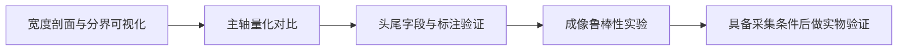

# 下一步工作路线

当前项目已具备离线分割、主轴估计、局部几何、头杆分析、亚像素细化、尺度换算和公差判定。本轮整理了共享流程及代码职责，保留原算法、默认参数和输出行为。第一阶段“展示测量中间过程”与第二阶段“量化三种主轴方法”均已于 2026-10-05 完成，分别见 [观察文档](diagnostics.md) 与 [主轴对照报告](axis_comparison.md)。其余阶段仍是后续计划。

已完成**宽度剖面与头杆分界可视化**和**三种主轴的量化对比**，下一项是**明确导出头尾结果并用人工标注验证**。前两项利用现有数据，补充了面试中“怎样计算、为什么选择、什么时候失败”的证据。实物验证放在具备采集条件后进行。

相关资料：[算法与计算细节](../README.md)、[面试讲述与成像预处理](interview.md)、[历史验证记录](validation.md)。

## 目录

- [阶段顺序与验收](#priorities)
- [1. 展示测量中间过程](#intermediate)
- [2. 量化三种主轴方法](#axes)
- [3. 明确导出头尾结果](#head-tail)
- [4. 做成像鲁棒性实验](#imaging)
- [5. 补实物测量证据](#physical)
- [如何组织一次可复盘的实验](#experiment)

## 阶段顺序与验收

| 优先级 | 工作 | 具体产物 | 验收目标 |
| --- | --- | --- | --- |
| 1 | 展示测量中间过程（已完成） | Lab 通道、候选过滤、局部掩膜、宽度剖面、阈值、分界、梯度曲线 | 能解释正常、反光、粘连各一个案例；开启观察前后测量结果一致 |
| 2 | 量化三种主轴方法（已完成当前数据范围） | 39 张合成、16 张代表图、4 张控制形状的误差／覆盖率表及失败案例 | 同图、同 mask、同候选比较；说明公共样本与失败范围；未扩大到 384 张全量 |
| 3 | 明确导出头尾结果 | 头部端、分界和有向角字段设计、人工标注样例 | 两种朝向均可验证；无法识别时明确缺失，与无向主轴区分 |
| 4 | 做成像鲁棒性实验 | 单因素扰动数据、原流程与候选预处理的对照报告 | 比较漏检、误检、尺寸偏差与细化覆盖率，记录有效范围 |
| 5 | 补实物测量证据 | 固定采集设置、适用尺度、独立尺寸真值、重复采集记录 | 分别评价偏差与波动，明确测量平面、尺度和成像条件 |

## 1. 展示测量中间过程

**状态：已完成。** 可选旁路记录、过程面板、CSV、无窗口保存入口及三类案例均已实现；观察开关一致性与保存路径已验证，见 [实现与验证范围](diagnostics.md#implementation)。以下保留本阶段目标与验收依据。

**目标：** 从“看到结果框”推进到“解释结果是怎样算出来的”，先改善学习和展示能力。

可以从 [共享测量流程](../src/pipeline.cpp) 和 [测量阶段函数](../src/metrology.cpp) 入手。分割阶段展示 L、b 通道与两条阈值条件；候选阶段展示连通域面积、轮廓面积、凸包占比及去留原因。测量阶段展示局部坐标轴、旋转后的 `local_mask`、原始截面宽度和中位数平滑后的 `profile`，标出 `shaft_baseline`、`head_ratio × shaft_baseline` 与头杆分界。

梯度图应至少包含一个成功细化和一个失败细化的截面，标出粗边缘、采样位置、梯度最大峰、相邻拟合点以及拒绝原因。横坐标注明像素偏移；局部剖面横坐标注明 s 坐标，不能把数组索引直接当作图像 x 坐标。

**产物：** 一个可保存的过程面板和三张带解释的案例卡片：正常分离螺钉、局部反光螺钉、疑似粘连目标。优先复用现有实验入口，不必先开发完整交互界面。

**验收：** 能在剖面上指出为什么只接受一端扩大、连续三个窄截面怎样确定分界、哪个梯度峰被拒绝。开启与关闭过程观察后，编号、尺寸、缺失值、状态及质量原因必须相同。观察代码应读取同一次计算中的阶段数据，避免为了展示另跑一套容易偏离的计算。

## 2. 量化三种主轴方法

**状态：已完成当前数据范围。** 已实现无窗口对照入口与统计脚本，完成 39 张合成、16 张固定代表图及 4 张控制案例。87 个匹配非近圆真值的 PCA／fitLine／旋转框平均无向误差为 0.7926°／1.0033°／5.6209°；尺寸、覆盖率与质量规则漏过范围见 [完整报告](axis_comparison.md)。全量三方法比较可后续扩展，以下保留本阶段目标与验收依据。

**目标：** 补齐选型证据。目前有 PCA 的历史方向误差记录，尚没有三种方法的全量量化比较。

每张图固定分割方法及参数，只生成一次 mask 和候选轮廓。对同一候选分别用 PCA、`fitLine`、旋转框长边方向重新测量；不能只替换输出角度，因为投影和剖面也依赖主轴。可先用 39 张合成图与 16 张代表图建立报告，再决定是否扩大到全量数据。

**产物：** 一张按方法比较的表，包含无向方向误差、各尺寸误差、可靠目标比例、细化覆盖率，以及按近圆、巨大头部、粘连和遮挡整理的失败案例。

**验收：** 方向按 180° 周期评价，并说明匹配门槛和近圆目标排除口径。真实旋转框标注可用于定位和主轴评价；缺少实物尺寸真值时，真实图不能给出尺寸精度成绩。尺寸比较先用合成真值，实物真值留到第五阶段。报告同时展示三个方法都有效的公共样本结果和各自失败数量，避免只统计成功样本掩盖差异。

面试时可据此回答“PCA 在哪些形状上更稳定，哪些形状会受宽头影响”，结论限定到数据与参数范围，不预设 PCA 一定最优。

## 3. 明确导出头尾结果

**目标：** 把内部头部端和分界变成有明确坐标约定、可评价的结果。当前 `head_end` 位于内部阶段结构，JSON 没有统一有向角，也没有独立尖端检测算法。

**产物：** 先设计字段说明，再实现导出。至少说明头部在局部负端还是正端、分界采用局部 s 坐标还是图像坐标、有向角表示“尾到头”还是“头到尾”、角度单位与周期。现有 `angle_deg` 保留无向主轴含义，新增结果需有明确的缺失语义与识别原因。

**验收：** 人工标注头部位于两种端部的样例，加入近圆、头杆宽差不足、两端都扩张、截断和粘连等无法确定案例。正常样例应给出正确端部与分界；不确定样例应缺失，不能任意采用 PCA 特征向量的符号作为头尾。评价可分别统计可判定覆盖率、端部正确率、有向角误差与分界误差，使用明确的分母。

先解决“头在哪端”，再考虑更精细的尖端定位或品类规则，不把尚未实现的尖端识别写进已完成成果。

## 4. 做成像鲁棒性实验

**目标：** 把曝光、过灰、噪声、模糊的口述处理建议变成实验依据。当前项目没有曝光补偿、Gamma 或 CLAHE 生产模块。

固定图像及几何真值，每组只改变一个因素：亮度偏移／增益、对比度缩放、噪声强度、失焦或运动模糊程度。保留未经扰动的对照组，记录扰动公式、强度、随机种子与饱和像素比例；不要同时修改分割阈值或形态学核来掩盖退化。

**产物：** 原流程与候选预处理方案的对照表和误差曲线。候选可以从线性拉伸、Gamma、CLAHE、背景校正、适量滤波中选择，具体诊断与教学代码见 [成像预处理专题](interview.md#preprocessing)。

**验收：** 同时检查漏检、误检、尺寸偏差、质量拒绝和细化覆盖率。明确增强用于分割支路还是灰度测量支路，两者分别验证；视觉上更清楚并不保证梯度峰位置或尺寸更准确。阈值如需重新选择，应单独记录配置，并用独立样本确认，避免把调参样本当成泛化证据。

过曝饱和造成的信息截断无法由增强恢复。软件实验只说明处理范围，采集端的曝光、增益、照明与白平衡仍需固定或独立验证。

## 5. 补实物测量证据

**前提：** 有相机、固定照明、可重复摆放工件的条件，以及适合所测尺寸的独立真值。现有合成图毫米换算结果不等于实物精度。

**产物：** 拍摄设置说明、分辨率与适用平面记录、尺度参考及选点记录、各工件独立尺寸真值、同一工件多次重新采集的图片。若明显存在镜头畸变或透视，应先量化其影响，再决定是否增加标定与校正，不能用单一 mm/px 假设直接覆盖整个视场。

**验收：** 尺寸定义需与真值一致，投影整体宽度不能直接与其他定义的直径混用。分别报告有符号偏差、MAE、最大绝对误差与重复测量标准差。把重复处理同一图、固定工件重复拍摄、重新摆放后重复拍摄分开记录；样本和条件不足时，不声明工业 GR&R 或产线精度。

## 如何组织一次可复盘的实验

每阶段完成一个小闭环：明确要回答的问题，冻结输入与配置，保存中间结果和评价，解释失败样例，再更新 README 或面试话术。

建议每个实验保留以下记录：

- 实验日期、源码版本、构建环境、输入清单与配置。
- 唯一变化项、坐标与尺寸定义、真值来源及排除口径。
- 各方案的数值指标和失败数量，正常及困难案例的解释。
- 已实现、已验证、仍待验证的范围，以及下一步最小改动。

输出使用独立目录，保留历史报告。优先让每个新增结论都能对应具体图像、参数和评价结果，再考虑扩大功能范围。
